# Лабораторная работа 2. REST API для CRUD-операций

**Выполнила:** Сергеева Виталия Викторовна, 02_МОАИС_рбд2

## Проектирование API

Ресурс: **User** (пользователь). Данные хранятся в памяти приложения, после перезапуска они очищаются.

| Поле | Тип | Правила |
|---|---|---|
| `id` | integer | выдаёт сервер |
| `name` | string | обязательное, 2–50 символов |
| `email` | string | обязательное, корректный формат, уникальное |
| `age` | integer | необязательное, 0–150 |
| `created_at` | string | дата создания, ставит сервер |

| Метод | Путь | Описание | Успех | Ошибки |
|---|---|---|---|---|
| GET | `/users` | список (параметры `page`, `limit`, `age_gt`, `search`) | 200 | 400 |
| POST | `/users` | создать пользователя | 201 + `Location` | 400, 409 |
| GET | `/users/{id}` | получить одного | 200 | 404 |
| PUT | `/users/{id}` | полностью заменить | 200 | 400, 404, 409 |
| DELETE | `/users/{id}` | удалить | 204 | 404 |

Ошибки возвращаются в едином формате: `{"error": {"status": 404, "message": "..."}}`.


API написано на Python с использованием Flask (`app.py`). В нём есть:

- 5 маршрутов для CRUD по таблице выше;
- валидация тела запроса (имя, email, возраст) и проверка уникальности email;
- пагинация списка (`items`, `total`, `page`, `page_size`, `pages`) и фильтры `age_gt` и `search`;
- JSON-обработчики ошибок 404, 405 и 500;
- маршруты `/openapi.yaml` (спецификация) и `/docs` (Swagger UI).

Запуск: `docker compose up --build`. Приложение доступно на `http://localhost:5000`, документация на `http://localhost:5000/docs`.

## Проверка работы

**Создание пользователя (POST /users).** Ответ `201 CREATED`, в заголовке `Location: /users/1` указан адрес нового ресурса.

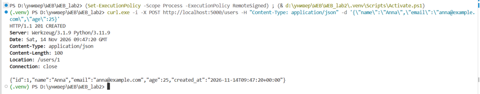

**Список пользователей (GET /users).** Ответ `200 OK`, в теле `items`, `total: 3`, `page: 1`, `pages: 1`.

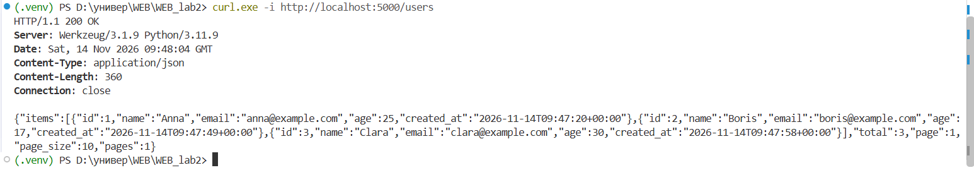

**Пагинация и фильтр.** При `page=1&limit=2` вернулось 2 пользователя и `pages: 2`. При `age_gt=18` вернулись только пользователи старше 18 лет (Anna и Clara).

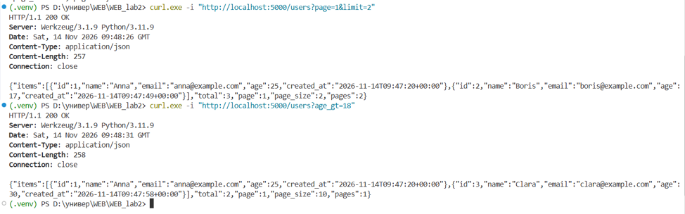

**Получение одного пользователя (GET /users/1).** Ответ `200 OK`.

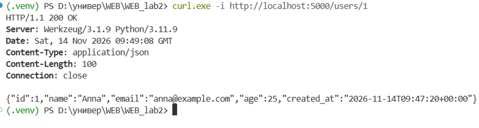

**Несуществующий пользователь (GET /users/999).** Ответ `404 NOT FOUND` и сообщение об ошибке в JSON.

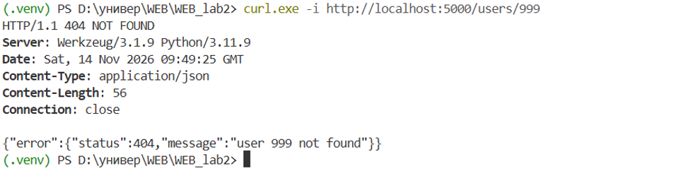

**Полное обновление (PUT /users/1).** Ответ `200 OK`: имя, email и возраст изменились, а `id` и `created_at` остались прежними.

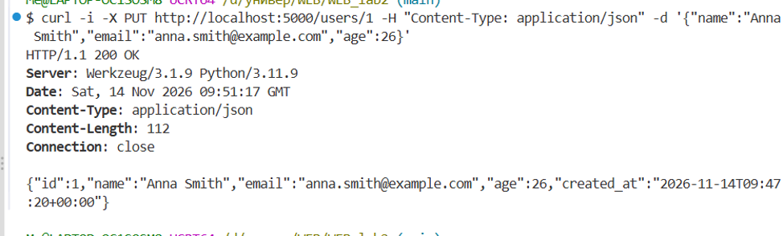

**Ошибка валидации.** При неверном имени и email сервер вернул `400 BAD REQUEST` и перечислил нарушенные правила.

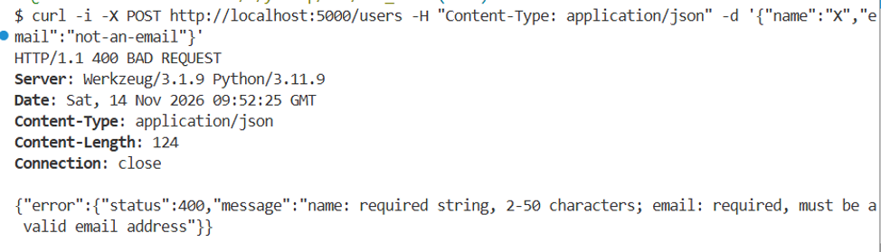

**Дубликат email.** Попытка создать пользователя с уже существующим email даёт `409 CONFLICT`.


**Удаление (DELETE /users/2).** Ответ `204 NO CONTENT`, тела ответа нет.

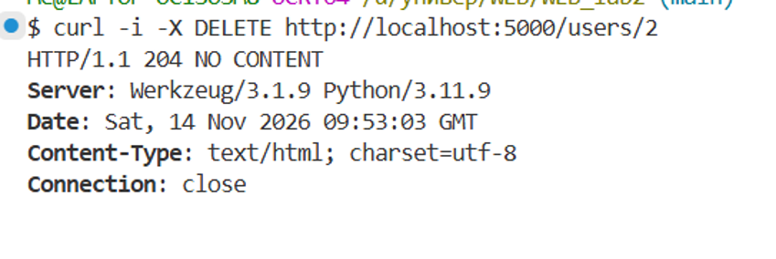

**Повторное удаление и чтение.** После удаления и `DELETE`, и `GET` для `/users/2` возвращают `404`. Состояние сервера после первого и повторного `DELETE` одинаковое (пользователя нет), поэтому `DELETE` идемпотентен.

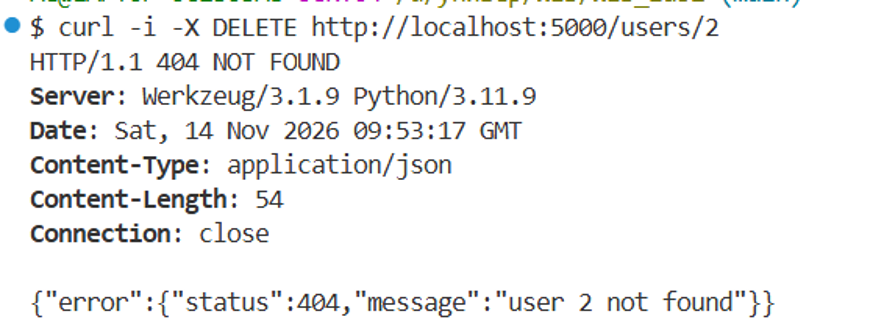

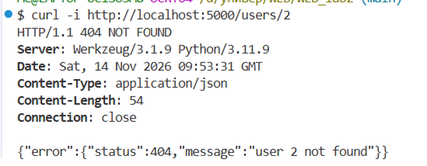

## OpenAPI-документация

API описано в файле `openapi.yaml` (версия OpenAPI 3.0.3): в нём указаны пути, методы, параметры, схемы данных и все возможные ответы с кодами.

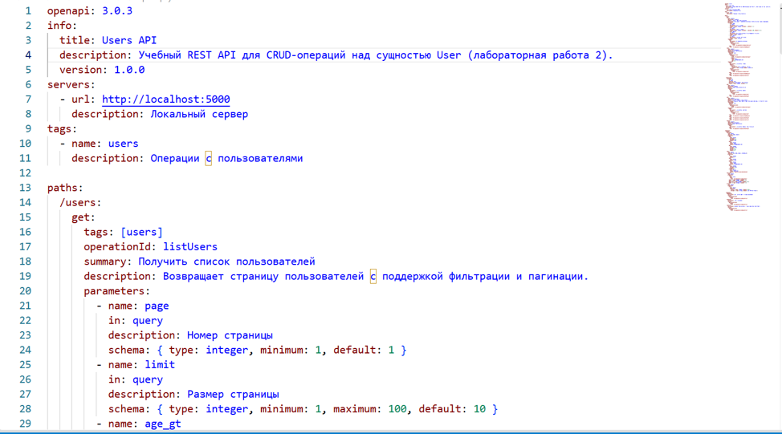

Файл отображается в Swagger UI по адресу `/docs`. На странице видны все пять операций.

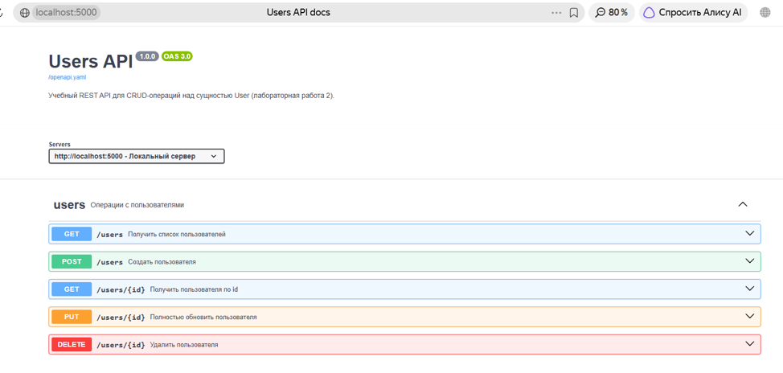

Раскрытая операция `POST /users`: пример тела запроса, ответы 201 (с заголовком `Location`), 400 и 409.

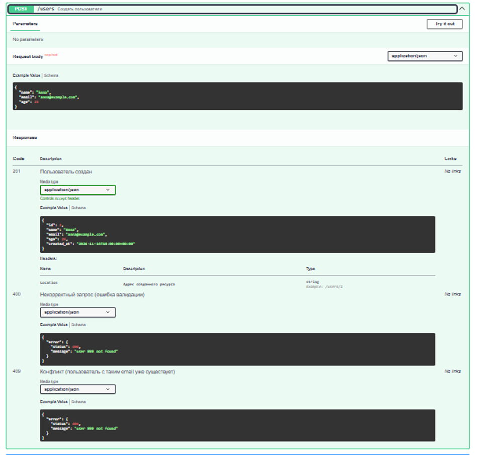

Схемы данных `UserInput`, `User`, `UserList` и `Error`.

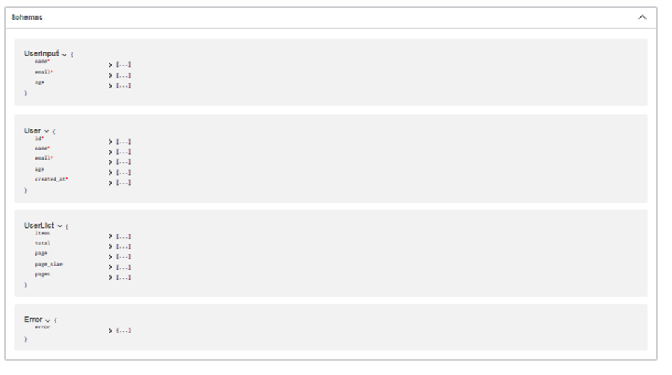

Swagger UI позволяет проверять API прямо в браузере (Try it out). Запрос `POST /users` вернул `201` и созданного пользователя:

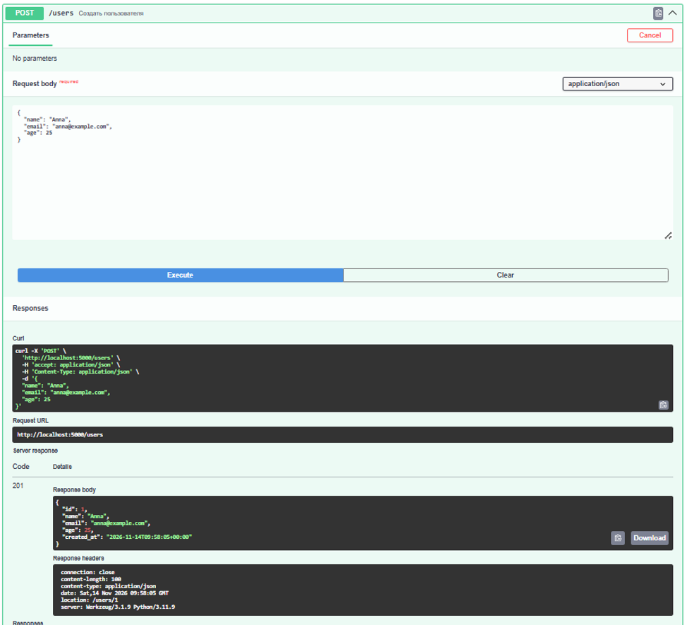

Запрос `GET /users/{id}` с `id = 999` вернул `404`:

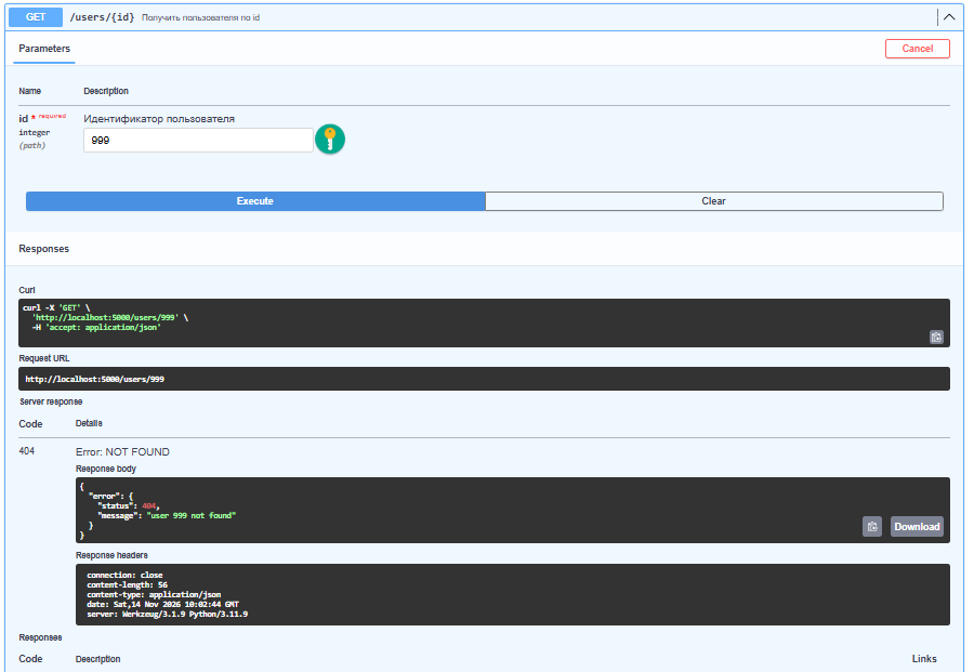

## Docker

`Dockerfile` такой же, как в лабораторной работе 1 (образ `python:3.11-slim`, сначала устанавливаются зависимости, потом копируется код). Запуск описан в `docker-compose.yml`:

```yaml
services:
  api:
    build: .
    container_name: web-lab2
    ports:
      - "5000:5000"
    restart: unless-stopped
```

Сборка и запуск командой `docker compose up -d --build`. Слои с зависимостями взяты из кэша (`CACHED`), поэтому сборка быстрая. Порт 5000 хоста проброшен в порт 5000 контейнера (`ports: "5000:5000"`).

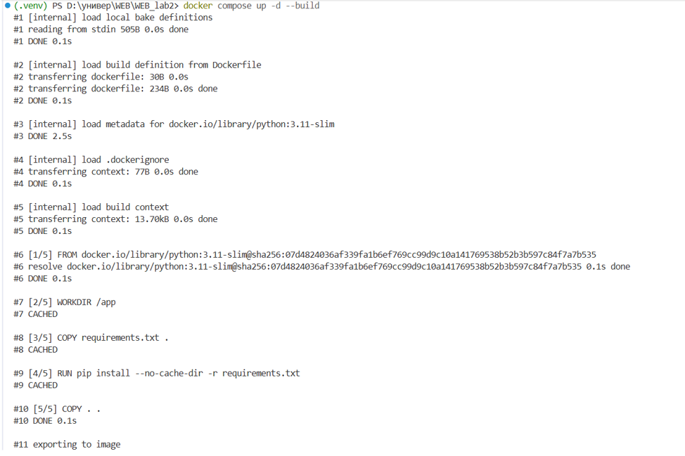

API работает в контейнере: пользователь создан (`201`), список возвращается (`200`, `total: 1`).

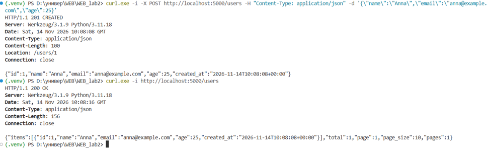

В логах контейнера видны запросы: `GET /docs` и `GET /openapi.yaml` с кодом 200. Повторный запрос `openapi.yaml` вернул `304 Not Modified`: браузер использовал свою закэшированную копию.

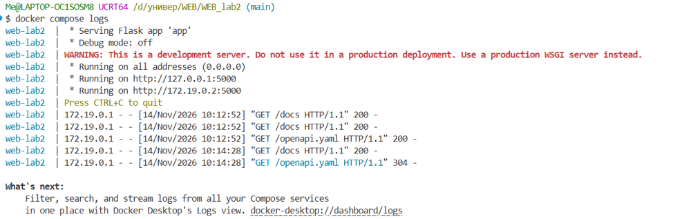


**Проектирование API блога:**

| Операция | Метод и путь |
|---|---|
| Создать пост | POST `/posts` |
| Список постов | GET `/posts` |
| Один пост | GET `/posts/{id}` |
| Обновить пост | PUT `/posts/{id}` |
| Удалить пост | DELETE `/posts/{id}` |
| Добавить комментарий | POST `/posts/{id}/comments` |
| Список комментариев | GET `/posts/{id}/comments` |
| Создать тег | POST `/tags` |
| Список тегов | GET `/tags` |

**Статус-коды:** успешное создание: 201, ресурс не найден: 404, неверные данные: 400, успешное удаление: 204.

**Вопрос для собеседования.** Создание пользователя: `POST /users` с JSON в теле, ответ `201 Created` с телом пользователя. Получение: `GET /users/123`, ответ `200 OK`. POST используется для создания, потому что он не идемпотентный, а GET для чтения, потому что он безопасный
