# Лабораторная работа 3. Валидация и обработка ошибок в API

**Выполнила:** Сергеева Виталия Викторовна, 03_МОАИС_рбд2

## Цель работы

Доработать API пользователей: добавить проверку входных данных (тип, формат, диапазон), бизнес-правила, обработку ошибок 4xx и 5xx в едином формате, понятные сообщения об ошибках и логирование. Проверить обычные, граничные и ошибочные сценарии.

## Структура проекта

```
laba3/
├── app.py            # маршруты, обработчики ошибок, логирование
├── errors.py         # классы ошибок API (статус, код)
├── validators.py     # проверка входных данных
├── requirements.txt
├── Dockerfile
├── docker-compose.yml
└── docs/             # скриншоты
```

Стек: Python 3.11, Flask. Данные хранятся в памяти приложения.

## Запуск

```bash
docker compose up -d --build
```

API доступно на `http://localhost:5000`. Логи пишутся в консоль и в файл `logs/app.log`. Без Docker: `ENABLE_DEBUG_ROUTES=1 python app.py` (переменная включает маршрут `/debug/crash`, нужный только для демонстрации ошибки 500).

### Endpoints

| Метод | Путь | Описание |
|---|---|---|
| GET | `/users` | список (параметры `page`, `limit`) |
| POST | `/users` | создать пользователя |
| GET | `/users/{id}` | получить пользователя |
| PUT | `/users/{id}` | обновить пользователя |
| DELETE | `/users/{id}` | удалить пользователя |

## Валидация входных данных

Проверка формата выполняется в `validators.py` до бизнес-правил.

| Поле | Правила |
|---|---|
| `name` | обязательное, строка, 2–50 символов, не пустая |
| `email` | обязательное, строка, формат `name@domain.xx`, до 254 символов |
| `age` | обязательное, целое число (не строка, не bool, не дробное), от 18 до 120 |
| `password` | только при создании: 8–128 символов, хотя бы одна буква и одна цифра |
| прочие поля | запрещены (`Unknown field`) |
| `page`, `limit` | целые числа: `page` от 1, `limit` от 1 до 100 |

Отдельно различаются случаи из лекции: поле **отсутствует** (`Field is required`), равно **null** (`Must not be null`), **пустая строка** (`Must not be empty`) и **ноль** (проверяется как обычное число, поэтому `age: 0` не проходит по диапазону). Все ошибки собираются сразу, а не по одной, чтобы клиент мог исправить запрос за один раз.

## Бизнес-правила

Они зависят от текущего состояния данных и проверяются после проверки формата.

| Правило | Ответ |
|---|---|
| Email должен быть уникальным | 409, `EMAIL_ALREADY_EXISTS` |
| Нельзя регистрироваться с одноразовыми почтовыми доменами (`tempmail.com`, `mailinator.com`) | 409, `BUSINESS_RULE_VIOLATION` |
| Возраст пользователя при обновлении нельзя уменьшать | 409, `BUSINESS_RULE_VIOLATION` |

Пароль хранится только в виде хэша и в ответах не возвращается.

## Формат ошибок

Все ошибки возвращаются в одном формате:

```json
{
  "error": "Validation error",
  "message": "Request validation failed",
  "code": "VALIDATION_ERROR",
  "details": {"age": "Must be between 18 and 120"},
  "request_id": "d958ae08"
}
```

`code` предназначен для программной обработки, `message` для человека, `details` указывает конкретное поле, а `request_id` помогает найти запрос в логах (он же возвращается в заголовке `X-Request-ID`).

| Ситуация | Статус | code |
|---|---|---|
| Ошибка валидации | 400 | `VALIDATION_ERROR` |
| Некорректный JSON | 400 | `INVALID_JSON` |
| Пользователь или маршрут не найден | 404 | `NOT_FOUND` |
| Неподдерживаемый метод | 405 | `METHOD_NOT_ALLOWED` |
| Дубликат email | 409 | `EMAIL_ALREADY_EXISTS` |
| Нарушение бизнес-правила | 409 | `BUSINESS_RULE_VIOLATION` |
| Непредвиденный сбой | 500 | `INTERNAL_ERROR` |

## Проверка сценариев

### Обычные сценарии

Создание пользователя вернуло `201 CREATED`, адрес нового ресурса указан в заголовке `Location`, пароля в ответе нет.

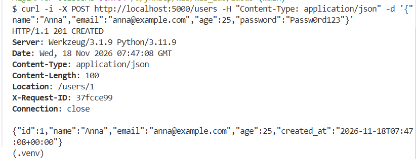

Список и получение одного пользователя вернули `200 OK`.

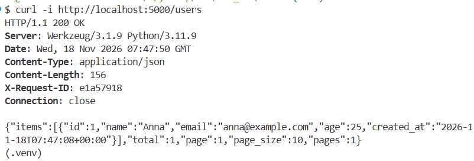

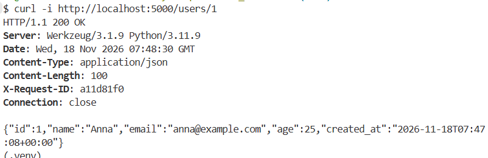

### Граничные сценарии

Допустимые границы возраста: 18 и 120 принимаются (`201`).

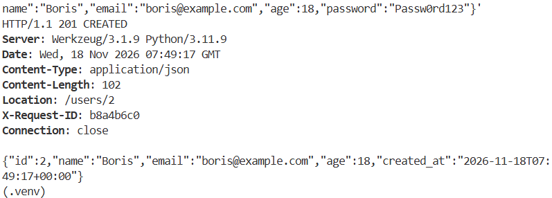

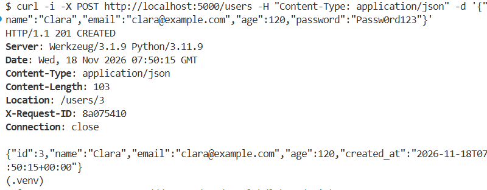

Значения за границами отклоняются: 17 и 121 (`400`, `Must be between 18 and 120`).

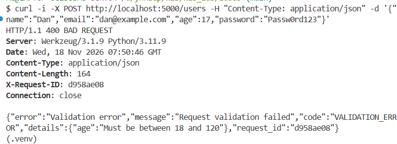

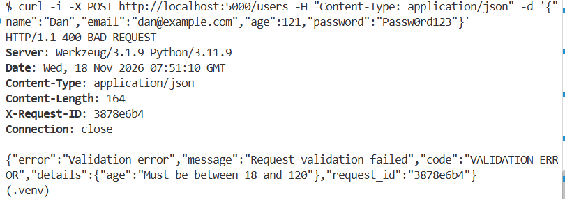

Возраст 0 тоже не проходит по диапазону, то есть ноль не считается «отсутствующим» значением.

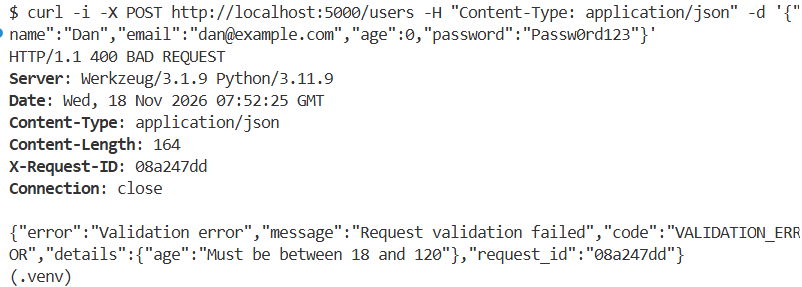

### Ошибочные сценарии: валидация (400)

Запрос с несколькими ошибками сразу (имя из одной буквы, неверный email, возраст 15, короткий пароль). В `details` перечислены все четыре поля.

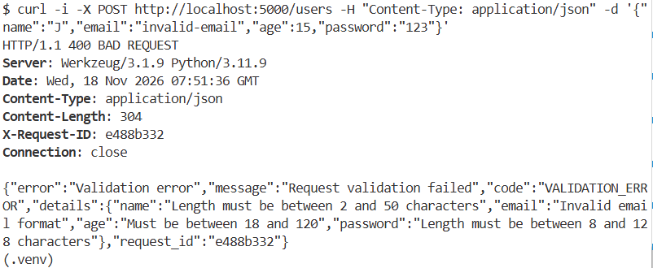

Различие между null, пустой строкой и отсутствующим полем: `name: null`, `email: ""`, поле `age` не передано.

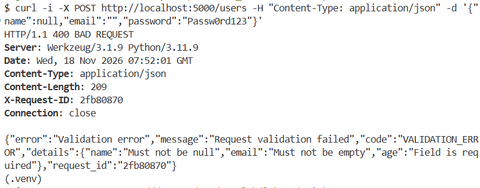

Некорректный JSON (`INVALID_JSON`).

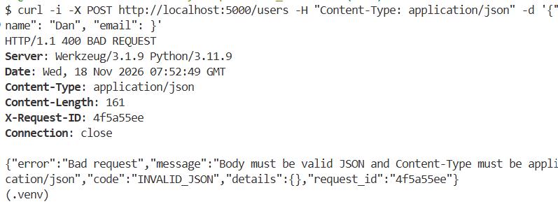

Лишнее поле `role` и пароль без цифры.

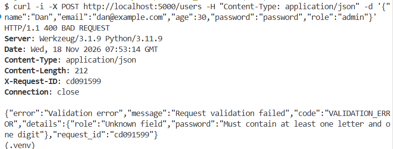

Неверные параметры списка: `page=0`, `limit=1000` и `page=abc`.

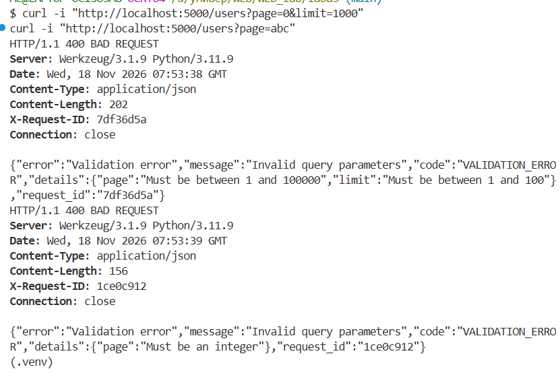

### Ошибочные сценарии: бизнес-правила (409)

Повторный email.

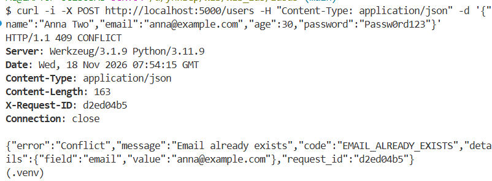

Запрещённый домен `mailinator.com`.

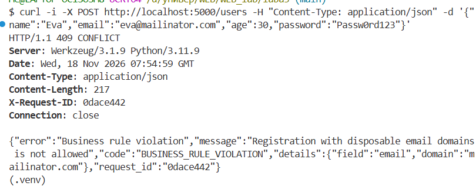

Попытка уменьшить возраст с 25 до 20 (в `details` указаны текущее и новое значения).

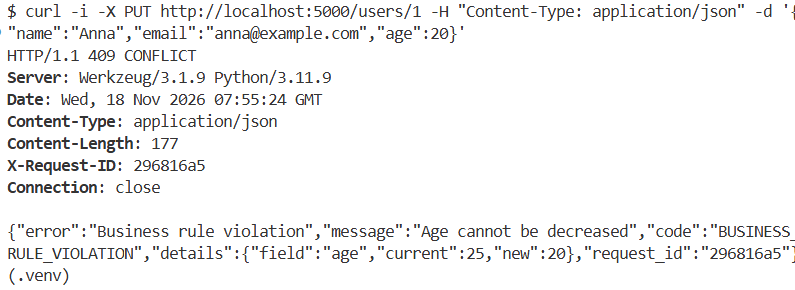

Для сравнения, обновление с возрастом 26 проходит успешно (`200`).

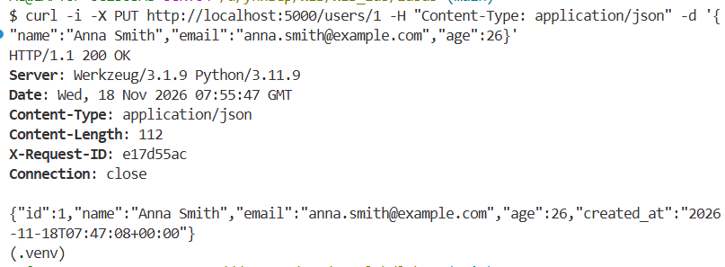

### Ошибки 404, 405 и 500

Несуществующий пользователь, несуществующий маршрут и неподдерживаемый метод `PATCH`. Ошибки самого Flask (404 и 405) тоже приведены к общему формату.

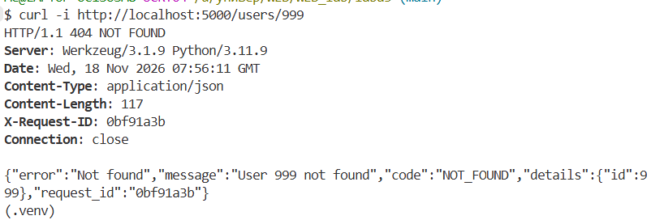

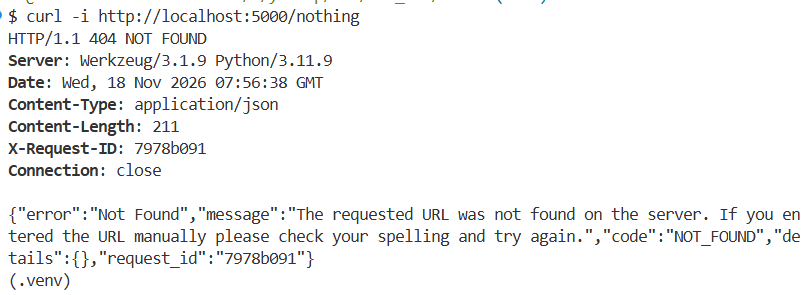

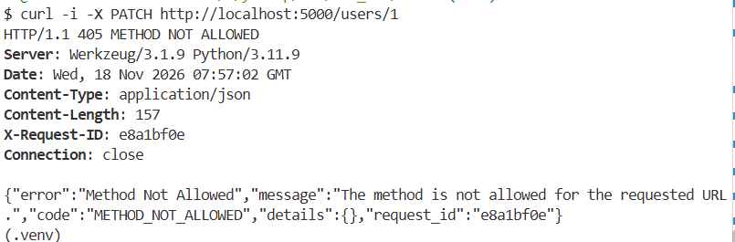

Внутренняя ошибка (искусственно вызванное исключение). Клиент получает только общее сообщение и `request_id`, без технических подробностей.

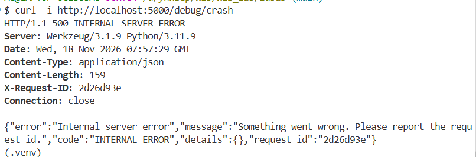

## Логирование

Логи пишутся в консоль и в файл `logs/app.log` в формате `время уровень [request_id] сообщение`. Уровни:

- `INFO` для каждого запроса (метод, путь, статус, время выполнения) и для успешных операций;
- `WARNING` для ошибок клиента (4xx) с кодом и деталями;
- `ERROR` для необработанных исключений (5xx) вместе со стеком вызовов (`Traceback`).

В консоли видно, что ошибки 400, 404, 405 и 409 записаны как `WARNING`, а ошибка 500 как `ERROR` со стеком. Идентификатор запроса `2d26d93e` совпадает с `request_id` из ответа на предыдущем скриншоте.

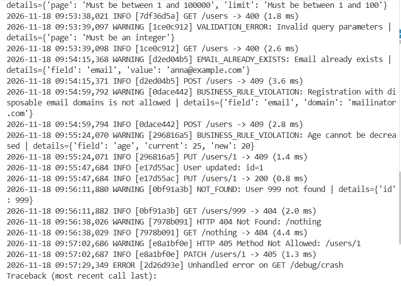

Файл `logs/app.log`:

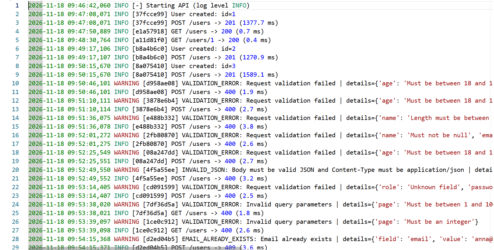

В логи не попадают пароли и email пользователей, при создании пишется только `id`. Полный стек ошибки остаётся в логе и не уходит клиенту.

## Docker

Образ собран, создана сеть и запущен контейнер `web-lab3`. Каталог `logs` подключён как volume.

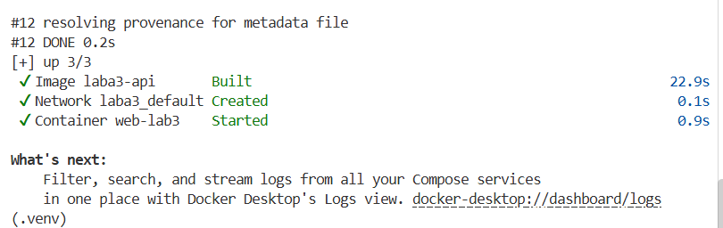

Проверка в контейнере: успешное создание (`201`) и запрос с ошибками (`400`). Здесь email `bad` не прошёл проверку длины (минимум 5 символов), поэтому сообщение другое, чем для `invalid-email`.

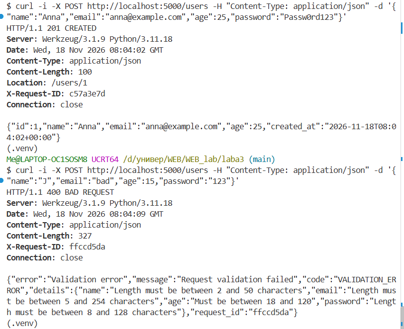

Логи контейнера в том же формате, что и при локальном запуске.

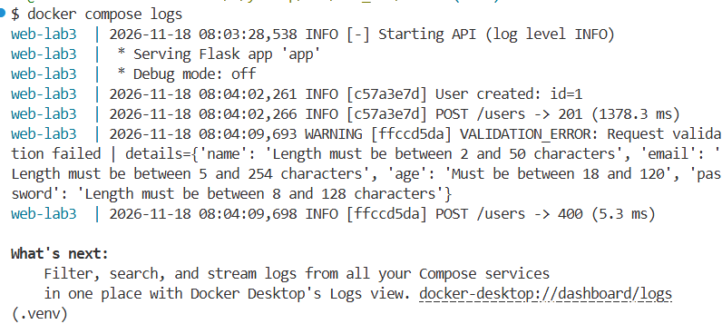
