# Лабораторная работа 4. Архитектура приложения с разделением слоёв

**Выполнила:** Сергеева Виталия Викторовна
## Архитектура

Запрос проходит по слоям сверху вниз, каждый слой знает только о следующем:

```
HTTP-запрос → Handler → Service → Repository → База данных (SQLite)
```

| Слой | Файл | За что отвечает | Чего не делает |
|---|---|---|---|
| Handler | `app/handlers/user_handler.py` | разбирает HTTP-запрос, проверяет формат данных, вызывает сервис, формирует ответ и статус | не содержит бизнес-правил и SQL |
| Service | `app/services/user_service.py` | бизнес-правила, хэширование пароля, отправка письма | не знает про HTTP и SQL |
| Repository | `app/repositories/user_repository.py` | SQL-запросы к базе | не содержит бизнес-логики |

Остальные части: `models.py` (модель `User`), `db.py` (обёртка над драйвером `sqlite3`), `errors.py` (доменные ошибки), `validators.py` (проверка формата), `handlers/common.py` (`request_id`, логирование запросов, обработка ошибок), `services/email_service.py` (имитация отправки письма).

### Структура проекта

```
laba4/
├── run.py                    # точка входа
├── Dockerfile
├── docker-compose.yml
├── requirements.txt
└── app/
    ├── __init__.py           # create_app(): сборка зависимостей
    ├── config.py             # настройки из переменных окружения
    ├── logging_config.py
    ├── errors.py
    ├── models.py
    ├── db.py
    ├── validators.py
    ├── handlers/
    ├── services/
    └── repositories/
```

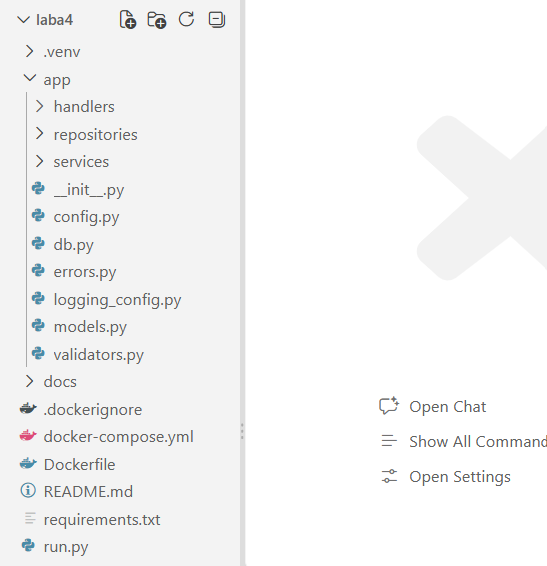

### Handler

Handler принимает запрос, проверяет формат данных и передаёт работу сервису. Он получает сервис снаружи, через параметр функции `create_user_blueprint(user_service)`.

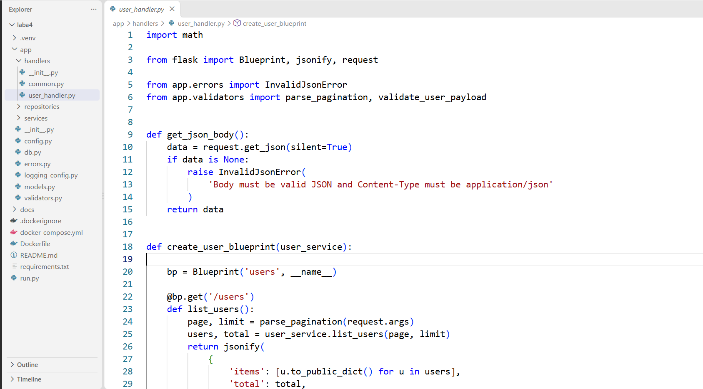

### Service

В сервисе находятся бизнес-правила: запрет одноразовых почтовых доменов, уникальность email, запрет уменьшать возраст при обновлении. Здесь же хэшируется пароль и вызывается `EmailService` (побочный эффект: «отправка» приветственного письма). Сервис не импортирует Flask и не пишет SQL, а зависимости получает в конструкторе.

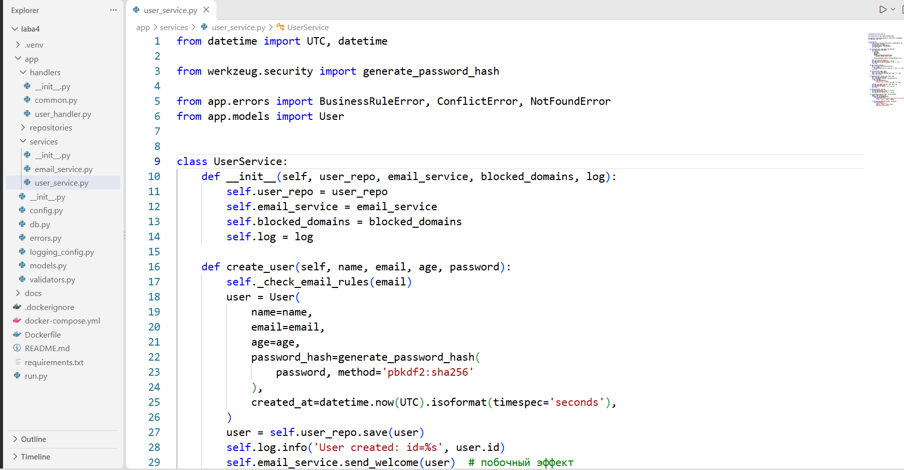

### Repository

Репозиторий отвечает только за доступ к данным. Все запросы параметризованные (`?`), значения не подставляются в строку SQL напрямую.

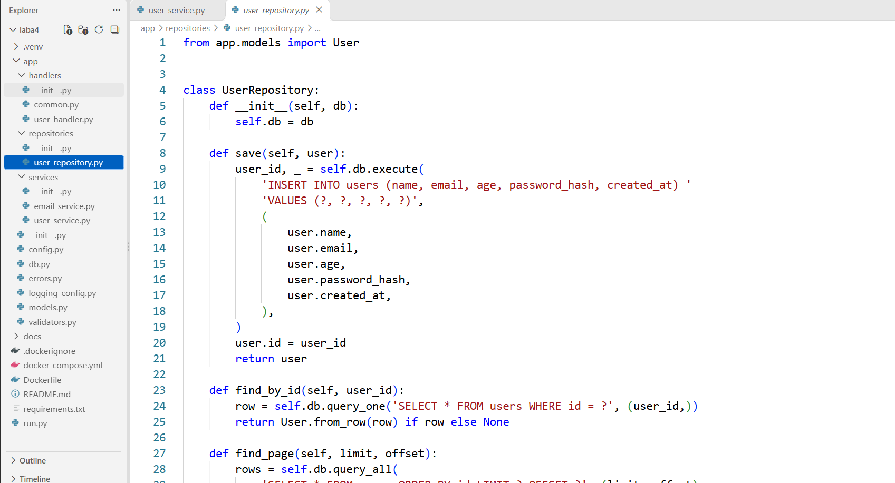

## Dependency Injection

Классы не создают свои зависимости сами, а получают их через конструктор. Вся сборка находится в одном месте, в функции `create_app()`:

```
Database → UserRepository → UserService (+ EmailService, настройки) → Handler
```

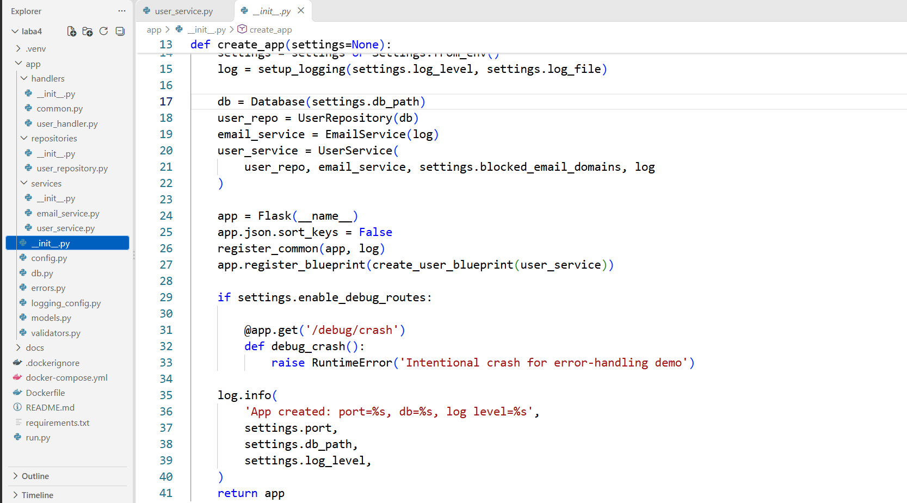

Благодаря этому любую часть можно заменить, например, в тестах подставить поддельный репозиторий вместо реальной базы, не меняя код сервиса. Это подготовка к тестированию.

## Конфигурация через переменные окружения

Настройки читаются в `app/config.py` один раз при старте. Если не задано, используется значение по умолчанию.

| Переменная | По умолчанию | Назначение |
|---|---|---|
| `APP_HOST` | `0.0.0.0` | адрес сервера |
| `APP_PORT` | `5000` | порт |
| `DB_PATH` | `data/app.db` | путь к файлу базы |
| `LOG_LEVEL` | `INFO` | уровень логирования |
| `LOG_FILE` | `logs/app.log` | файл логов |
| `BLOCKED_EMAIL_DOMAINS` | `tempmail.com,mailinator.com` | запрещённые почтовые домены |
| `ENABLE_DEBUG_ROUTES` | `0` | демонстрационный маршрут `/debug/crash` |

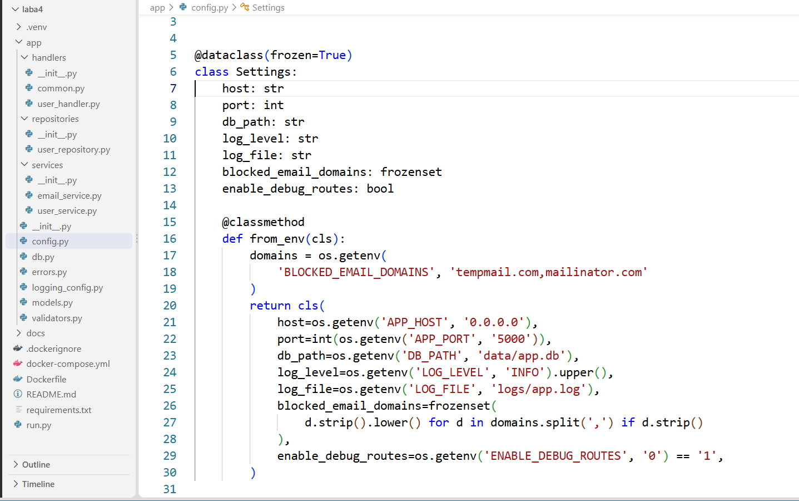

Запуск сервера (в логе видно, какие настройки применены):

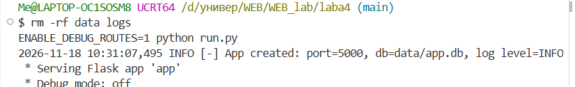

### Проверка: настройки меняются без изменения кода

Сервер запущен с другим портом, другой базой и другим списком запрещённых доменов:

```bash
APP_PORT=5001 DB_PATH=data/demo.db BLOCKED_EMAIL_DOMAINS=spam.org python run.py
```

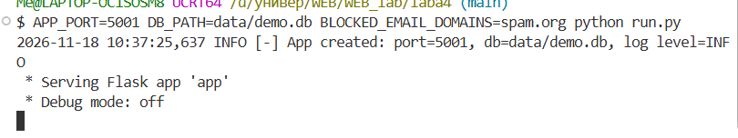

Теперь домен `spam.org` запрещён (`409`, `BUSINESS_RULE_VIOLATION`):

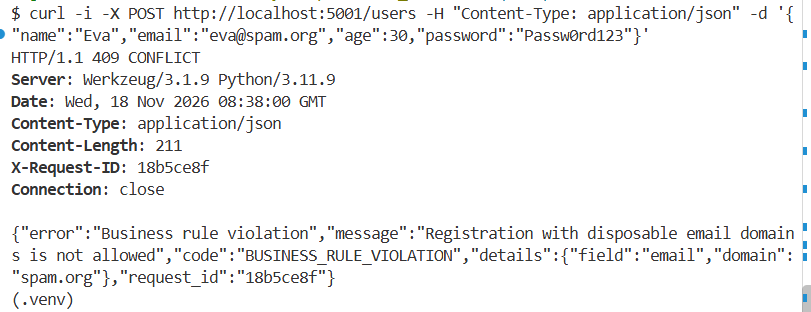

А `mailinator.com`, запрещённый по умолчанию, больше не блокируется (`201`):

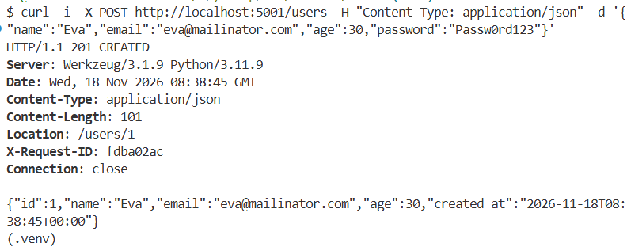

## База данных

Используется SQLite через стандартный драйвер `sqlite3`. Таблица `users` создаётся при старте приложения: `id`, `name`, `email` (уникальный), `age`, `password_hash`, `created_at`. Файл базы создаётся в папке `data`:

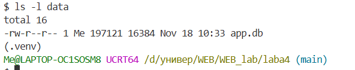

Содержимое таблицы после операций (создание, обновление, удаление второго пользователя). Пароль хранится только в виде хэша:

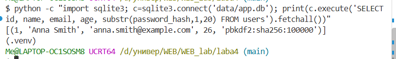

## Проверка работы API

После рефакторинга API работает так же, как в лабораторной 3: те же маршруты, статусы и формат ошибок.

| Операция | Результат | Скриншот |
|---|---|---|
| Создание пользователя | `201 CREATED`, `Location: /users/1` | 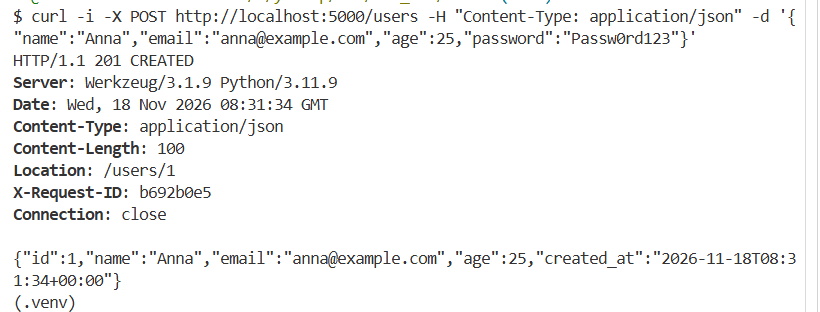 |
| Список пользователей | `200 OK`, `total: 2` | 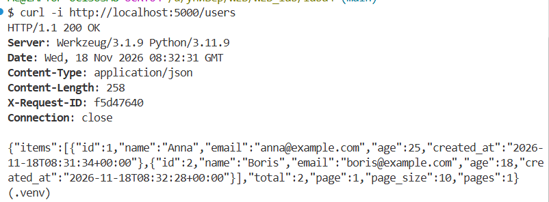 |
| Получение одного | `200 OK` | 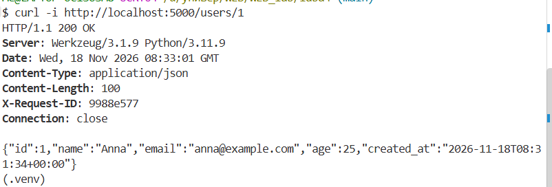 |
| Обновление (PUT) | `200 OK`, данные изменены | 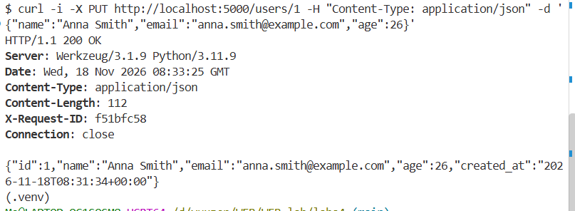 |
| Удаление | `204 NO CONTENT` | 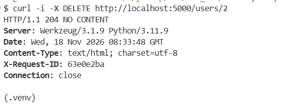 |
| Ошибка валидации | `400`, ошибки по четырём полям | 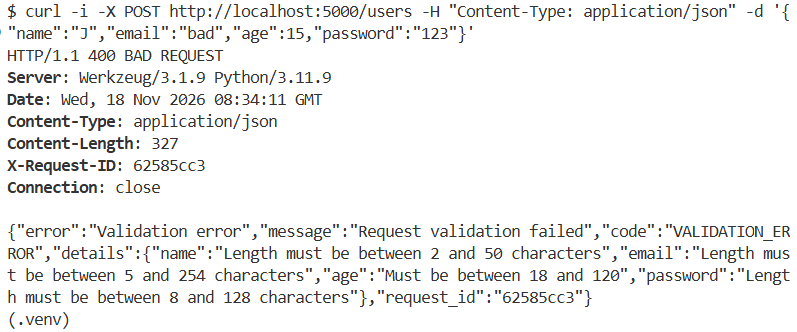 |
| Дубликат email (правило сервиса) | `409`, `EMAIL_ALREADY_EXISTS` | 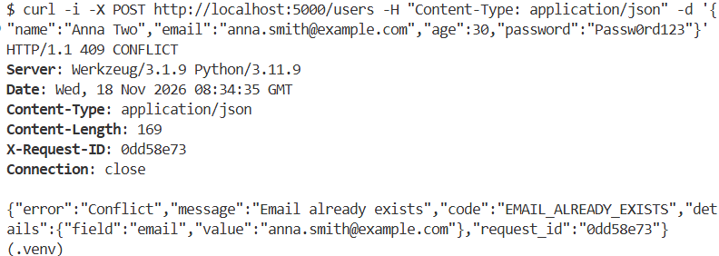 |
| Пользователь не найден | `404`, `NOT_FOUND` | 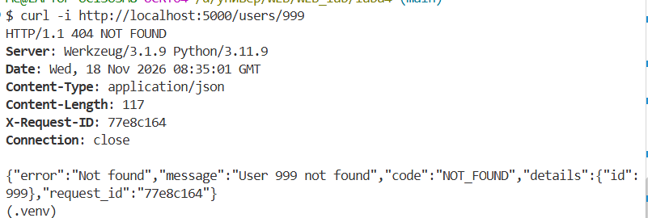 |
| Внутренняя ошибка | `500`, `INTERNAL_ERROR`, без технических деталей | 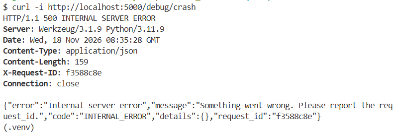 |

Доменные ошибки (`NotFoundError`, `ConflictError` и другие) не знают про HTTP. В соответствие статус-кодам (404, 409 и т. д.) их ставит только слой handlers.

## Docker

Запуск описан в `docker-compose.yml`. Настройки передаются через `environment`, а база данных лежит в именованном томе `db_data`, поэтому не пропадает при перезапуске контейнера. Логи пишутся в папку `logs` на хосте.

```yaml
services:
  api:
    build: .
    container_name: web-lab4
    ports:
      - "5000:5000"
    environment:
      - DB_PATH=/app/data/app.db
      - BLOCKED_EMAIL_DOMAINS=tempmail.com,mailinator.com
    volumes:
      - db_data:/app/data
      - ./logs:/app/logs
volumes:
  db_data:
```

(В файле также заданы `APP_HOST`, `APP_PORT`, `LOG_LEVEL`, `ENABLE_DEBUG_ROUTES` и `restart`.)

Сборка и запуск (`docker compose up -d --build`): создан образ, сеть, том `laba4_db_data` и контейнер.

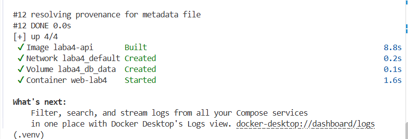

Состояние контейнера:

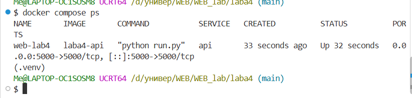

Проверка в контейнере: пользователь создан (`201`), список возвращается (`200`).

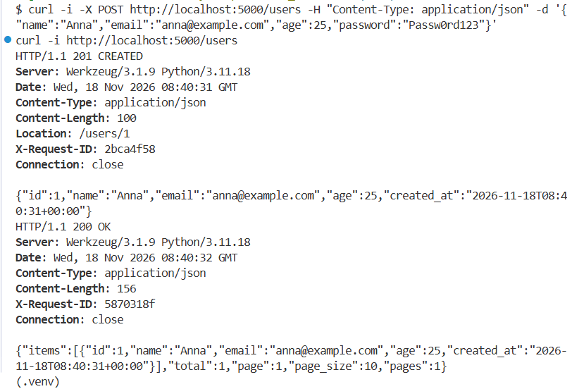

**Данные сохраняются после перезапуска.** После `docker compose restart` пользователь Anna по-прежнему в списке, потому что база хранится в томе, а не внутри контейнера.

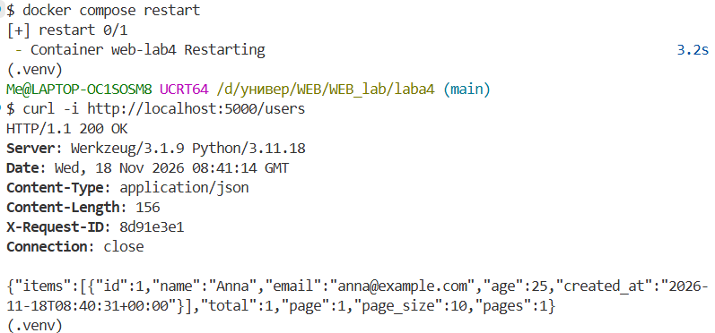

В логах контейнера видно создание пользователя, «отправку» письма (`Welcome email sent to user id=1`), запросы и второй запуск приложения после перезапуска:

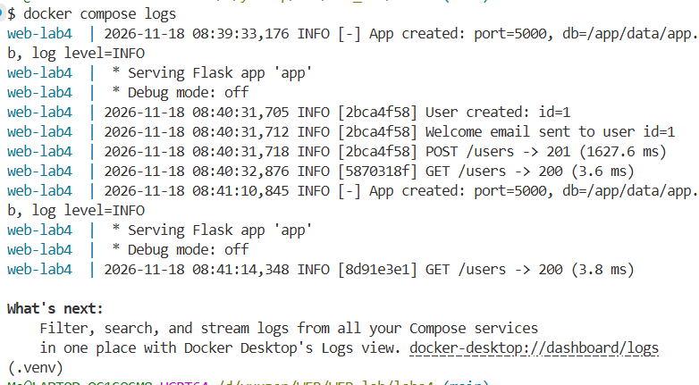
