# Лабораторная работа 5. Тестирование API

**Выполнила:** Сергеева Виталия Викторовна, 03_МОАИС_рбд2

## Инструменты и окружение

Python 3.11, `pytest` для запуска тестов, `pytest-cov` для измерения покрытия, `unittest.mock` для подмены зависимостей. Зависимости установлены в виртуальное окружение, список сохранён в `requirements-dev.txt` (в `requirements.txt` остался только Flask для Docker-образа).

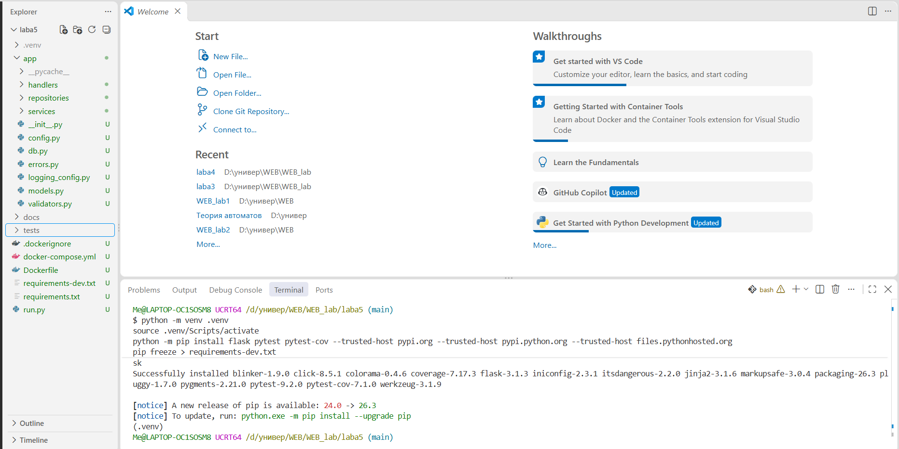

## Структура тестов

Код приложения (папка `app/`) взят из лабораторной 4 без изменений.

| Файл | Уровень | Что проверяет | Тестов |
|---|---|---|---|
| `test_validators.py` | unit | проверка формата данных и параметров списка | 52 |
| `test_user_service.py` | unit (с моками) | бизнес-логика сервиса | 18 |
| `test_email_service.py` | unit | сервис писем | 1 |
| `test_config.py` | unit | настройки из переменных окружения | 3 |
| `test_user_repository.py` | integration | репозиторий с реальной SQLite | 11 |
| `test_service_integration.py` | integration | сервис + репозиторий + БД | 3 |
| `test_api_users.py` | integration | HTTP: обычные и граничные сценарии | 23 |
| `test_api_errors.py` | integration | HTTP: ошибочные сценарии | 26 |
| **Итого** | | | **137** |

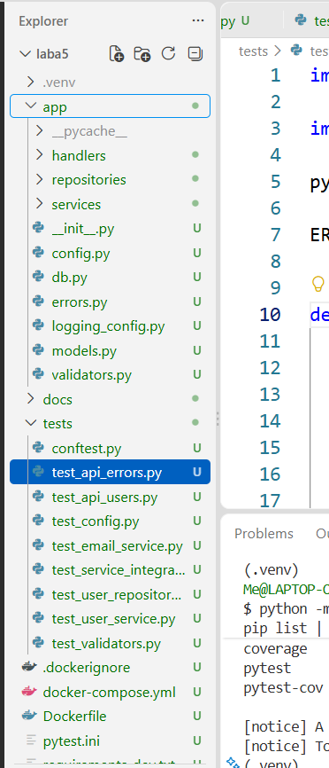

Настройки `pytest.ini` (путь к проекту, маркеры тестов) и общие фикстуры в `conftest.py`. Фабрика `make_app` создаёт приложение с временной базой данных, поэтому каждый тест работает с чистой базой и не зависит от других.

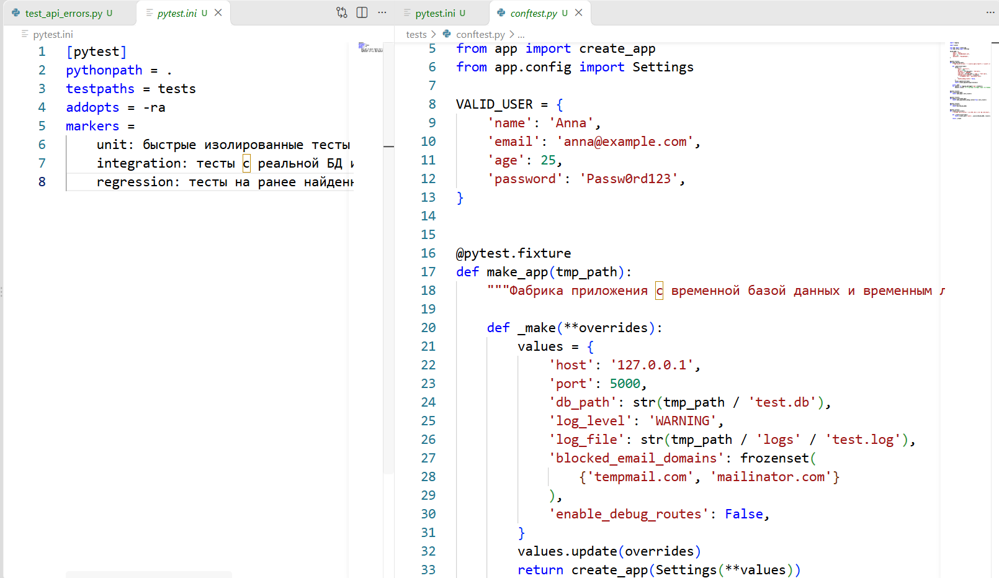

## Уровни тестирования

| Уровень | Особенности | Что у меня |
|---|---|---|
| Unit | быстрые, изолированные, зависимости подменены моками | валидаторы, сервис, сервис писем, конфигурация |
| Integration | проверяют взаимодействие компонентов, реальная база | репозиторий, сервис с БД, API через тестовый клиент Flask |
| E2E | полный запрос с реальным окружением | в лабораторной не требуется |

## Шаблон Arrange-Act-Assert и моки

Каждый тест написан по схеме: подготовка (Arrange), действие (Act), проверка (Assert). В unit-тестах сервиса репозиторий и сервис писем заменены моками, поэтому база данных не нужна и тест выполняется быстро. Мок создан через `create_autospec`: он повторяет методы настоящего класса, и тест упадёт, если вызвать метод, которого у класса нет (так мок не расходится с реальностью).

Помимо проверки результата, тесты проверяют и побочные эффекты: например, при дубликате email репозиторий не вызывает `save`, а письмо не отправляется (`assert_not_called`). Подменены также время (`patch` для `datetime`) и переменные окружения (`monkeypatch`).

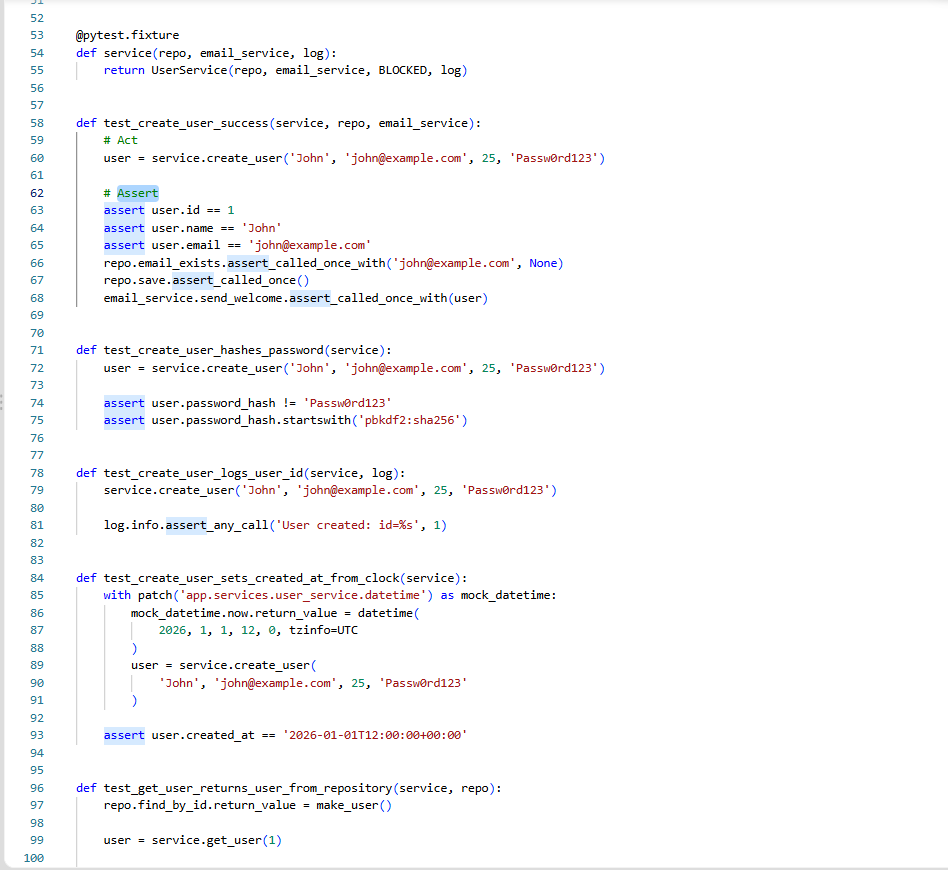

## Unit-тесты

**Валидаторы.** Проверяются все правила для имени, email, возраста и пароля, параметры списка, а также неизвестные поля и тело запроса не в виде объекта (52 теста, `52 passed`).

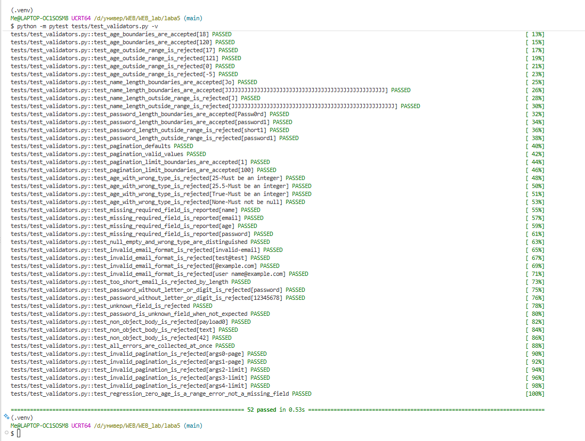

**Сервис с моками.** Проверены создание пользователя (хэширование пароля, вызов репозитория и сервиса писем, логирование, время), чтение, список с пагинацией, обновление, удаление и все бизнес-правила (18 тестов).

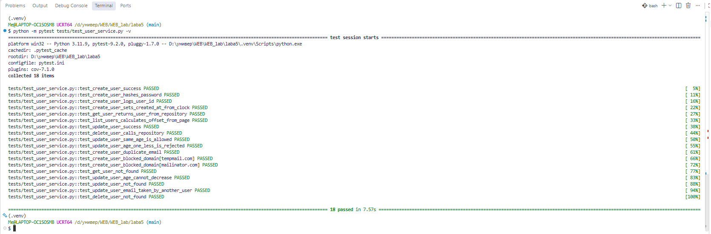

**Сервис писем и конфигурация.** Письмо логирует только `id` пользователя, а не его email. Настройки читаются из переменных окружения, при неверном порте приложение сразу падает при старте (4 теста).

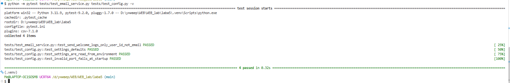

## Integration-тесты

**Репозиторий с реальной SQLite** (временная база в папке `tmp_path`). Проверяются сохранение, обновление, удаление, пагинация, сохранение данных после повторного открытия базы, ограничение уникальности email и защита от SQL-инъекций (значение `Robert'); DROP TABLE users;--` сохраняется как обычный текст).

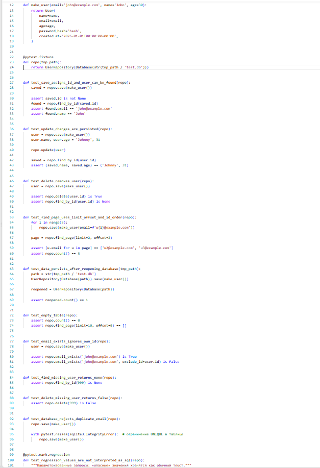

**Сервис вместе с репозиторием.** Пользователь действительно записывается в БД, дубликат email отклоняется реальной проверкой, изменения видны в базе (14 тестов вместе с репозиторием).

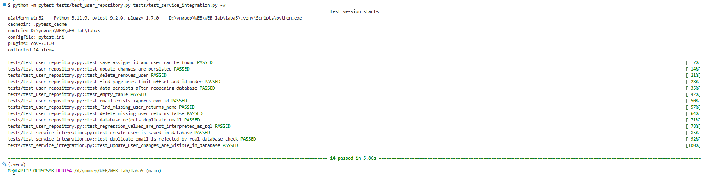

**API через тестовый клиент Flask.** Запрос проходит весь путь Handler → Service → Repository → БД.

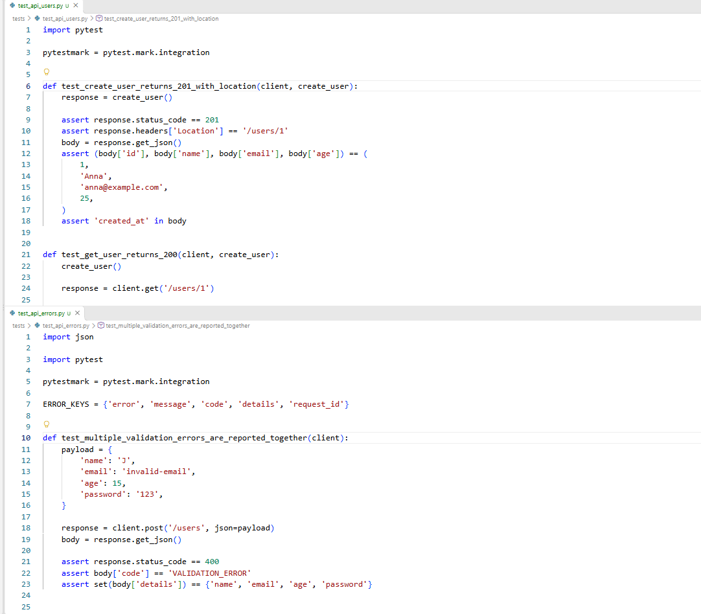

Обычные и граничные сценарии (23 теста):

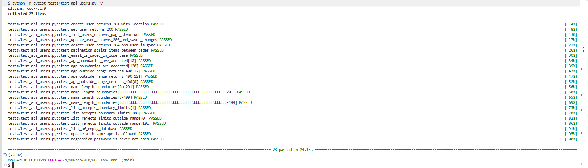

Ошибочные сценарии (26 тестов):

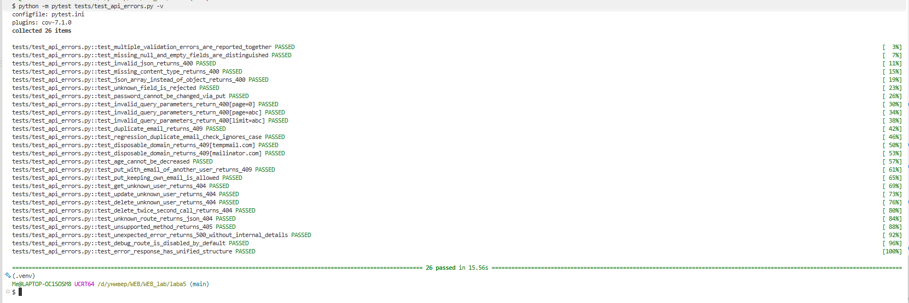

## Сценарии

| Тип | Примеры |
|---|---|
| Обычные | создание (`201` и `Location`), чтение, список, обновление, удаление (`204`), пагинация |
| Граничные | возраст 18 и 120 принимаются, 17, 121 и 0 отклоняются; длина имени 2 и 50 против 1 и 51; `limit` 1 и 100 против 0 и 101; пустой список; обновление с тем же возрастом |
| Ошибочные | несколько ошибок валидации сразу; `null`, пустая строка и отсутствие поля; битый JSON; массив вместо объекта; лишнее поле; дубликат email; запрещённый домен; уменьшение возраста; несуществующий пользователь, маршрут и метод (404, 405); внутренняя ошибка 500 без технических деталей |

Все ошибки проверяются на единый формат (`error`, `message`, `code`, `details`, `request_id`), а `request_id` совпадает с заголовком `X-Request-ID`.

## Регрессионные тесты и маркеры

Тесты помечены маркерами `unit`, `integration` и `regression`, поэтому группы можно запускать отдельно. Регрессионные тесты защищают от повторного появления ошибок: ноль в качестве возраста не считается «отсутствующим полем», пароль не возвращается в ответах, email сравнивается без учёта регистра, email не попадает в лог, SQL-инъекции не работают.

```bash
python -m pytest -m unit -q          # 74 теста
python -m pytest -m integration -q   # 63 теста
python -m pytest -m regression -q    # 5 тестов
```

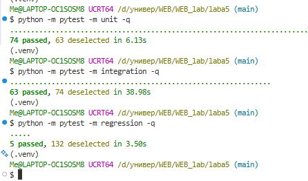

## Результат запуска всех тестов

```bash
python -m pytest -q
```

Все 137 тестов проходят.

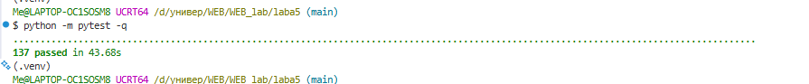

## Покрытие кода

```bash
python -m pytest --cov=app --cov-branch --cov-report=term-missing -q
python -m pytest --cov=app --cov-branch --cov-report=html -q
```

Общее покрытие 99% (все 362 строки выполнены, из 66 ветвлений непокрытыми остались 2 частичных).

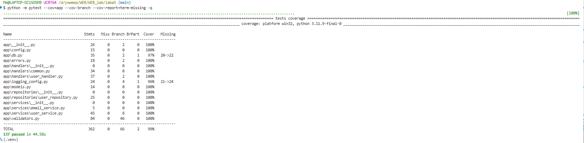

HTML-отчёт:

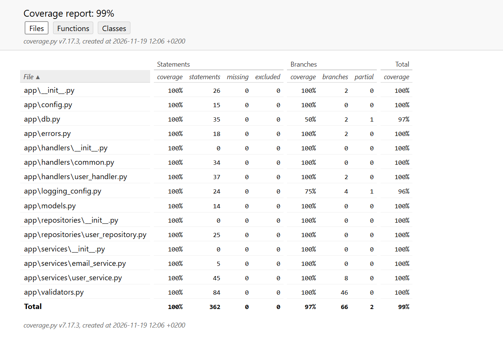

Не покрыты только две ветки: в `db.py` и в `logging_config.py` ветка `if`, когда путь к файлу указан без папки. На логику приложения это не влияет. Высокий процент покрытия не доказывает отсутствие ошибок, он только показывает, что код выполнялся при тестах, поэтому в тестах проверяются конкретные значения и ошибочные сценарии.

## Проверка, что тесты ловят ошибки

Чтобы убедиться, что тесты действительно проверяют поведение, я намеренно сломала правило в `user_service.py`: условие `if age < user.age` заменила на `if age <= user.age` (тогда нельзя обновить пользователя с тем же возрастом). Результат: упали три теста из разных уровней, один unit-тест сервиса и два теста API.

- `test_update_user_same_age_is_allowed` (unit)
- `test_update_with_same_age_is_allowed` (API)
- `test_put_keeping_own_email_is_allowed` (API, этот запрос тоже обновляет пользователя с тем же возрастом)

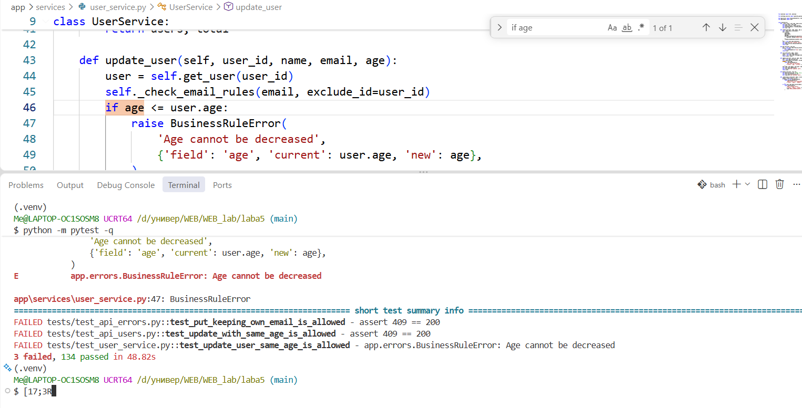

После возврата `<` все 137 тестов снова проходят.

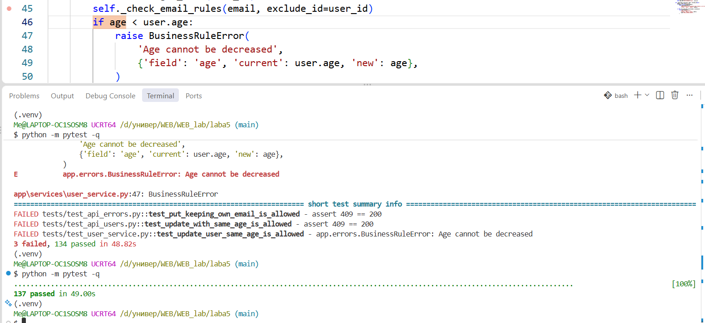


**Задание 1 (unit-тест валидации email).** Тесты `test_valid_emails_are_accepted` и `test_invalid_email_format_is_rejected` в `test_validators.py` проверяют корректные адреса и неверные (`invalid-email`, `test@test`, `@example.com`, адрес с пробелом).

**Задание 2 (integration-тест создания пользователя).** `test_create_user_is_saved_in_database` в `test_service_integration.py` создаёт пользователя через сервис с реальной БД и проверяет, что он записан в базе.

**Задание 3 (сценарии).** Обычный (создание пользователя), граничный (возраст 18 и 120), ошибочный (дубликат email или возраст вне диапазона), см. раздел «Сценарии».


