# Лабораторная работа 6. Аутентификация и работа с базой данных

**Выполнила:** Сергеева Виталия Викторовна, 03_МОАИС_рбд2

## Цель работы

Добавить в API систему аутентификации, перевести работу с данными на базу данных со схемой, которая создаётся миграциями, и реализовать профили пользователей с разграничением прав.

## Что реализовано и почему

| Задача | Решение |
|---|---|
| Аутентификация | сессии на cookie (cookie хранит токен, сама сессия лежит в БД) |
| База данных | SQLite через драйвер `sqlite3`, CRUD по таблицам `users`, `sessions`, `profiles` |
| Параметризованные запросы | во всех запросах значения передаются через `?` |
| Миграции схемы | собственный инструмент `migrate.py` (команды `status`, `up`, `down`), файлы `.up.sql` и `.down.sql` |
| Профили пользователей | профиль (`bio`, `city`): читать может любой вошедший пользователь, менять только владелец |

Сессии выбраны вместо JWT, потому что при выходе сессия удаляется на сервере и сразу перестаёт действовать, а состояние хранится в БД и не пропадает при перезапуске сервера. В базе хранится не сам токен, а его хэш (SHA-256), поэтому утечка базы не раскрывает действующие сессии. Приложение построено по слоям из лабораторной 4: Handler → Service → Repository.

### Endpoints

| Метод | Путь | Доступ | Коды ответа |
|---|---|---|---|
| POST | `/auth/register` | всем | 201, 400, 409 |
| POST | `/auth/login` | всем | 200 (+ `Set-Cookie`), 400, 401 |
| POST | `/auth/logout` | всем | 204 |
| GET | `/me` | вошедшим | 200, 401 |
| DELETE | `/me` | вошедшим | 204, 401 |
| GET | `/users/{id}/profile` | вошедшим | 200, 401, 404 |
| PUT | `/users/{id}/profile` | только владелец | 200, 400, 401, 403 |
| DELETE | `/users/{id}/profile` | только владелец | 204, 401, 403 |

Код 401 значит «не вошли» (нет или недействительна сессия), 403 значит «вошли, но это чужой ресурс».

## Миграции

Схема базы создаётся не приложением, а миграциями из папки `migrations/`. У каждой миграции есть файл применения (`.up.sql`) и файл отката (`.down.sql`). Применённые версии записываются в таблицу `schema_migrations`.

| Миграция | Что делает |
|---|---|
| 001 | таблица `users` |
| 002 | таблица `sessions` (внешний ключ на `users`, `ON DELETE CASCADE`) |
| 003 | таблица `profiles` (внешний ключ на `users`, `ON DELETE CASCADE`) |
| 004 | столбец `last_login_at` в `users` |

Команды: `python migrate.py status` (состояние), `python migrate.py up` (применить), `python migrate.py down` (откатить последнюю).

До применения все три миграции в статусе `pending`:

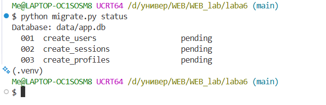

После `up` они применены:

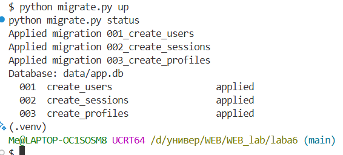

Схема базы: таблицы `users`, `sessions`, `profiles` и служебная `schema_migrations`.

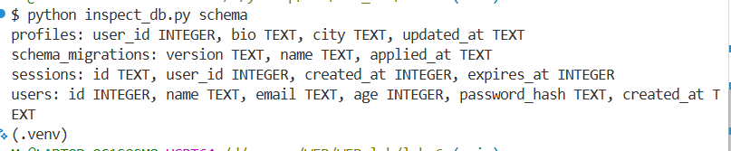

Затем я добавила четвёртую миграцию (изменение схемы) и применила её:

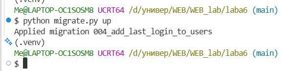

В таблице `users` появился столбец `last_login_at`:

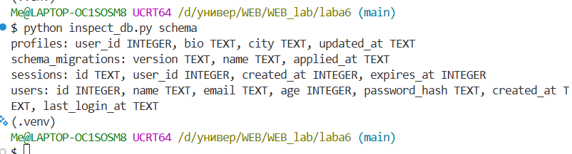

Откат последней миграции (`down`) удалил этот столбец:

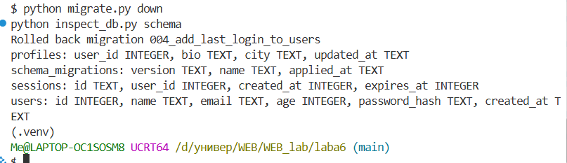

Повторный `up` снова применил миграцию 004, все четыре миграции применены:

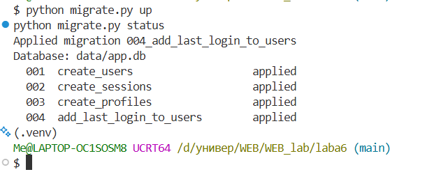

Структура проекта:

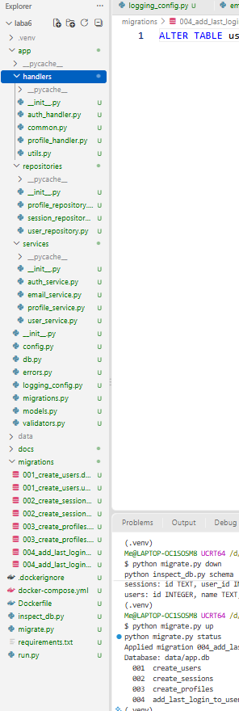

## Аутентификация

### Как работает вход

1. `POST /auth/login`: сервер находит пользователя по email и проверяет пароль по хэшу.
2. Создаётся случайный токен, в таблицу `sessions` записывается его хэш, `user_id` и время окончания.
3. Токен отправляется браузеру в cookie. Атрибуты cookie: `HttpOnly` (недоступна из JavaScript), `SameSite=Lax` (не отправляется с чужих сайтов), `Secure` (только по HTTPS, включается переменной окружения `COOKIE_SECURE`, на локальном HTTP отключён), `Max-Age` (срок жизни).
4. При следующих запросах браузер присылает cookie, сервер по хэшу токена находит сессию и пользователя. Проверку делает декоратор `login_required`.

Код сервиса аутентификации (хэширование токена, проверка пароля, создание и проверка сессии):

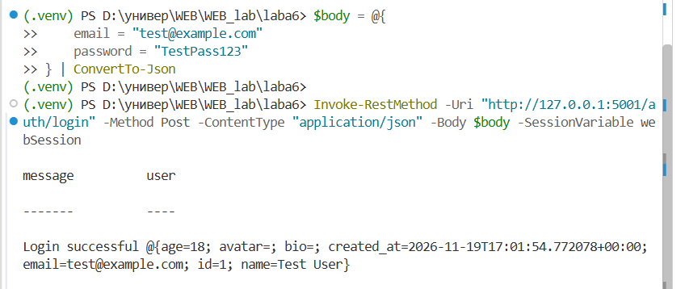

Код handler: установка cookie с атрибутами безопасности, `login_required`:

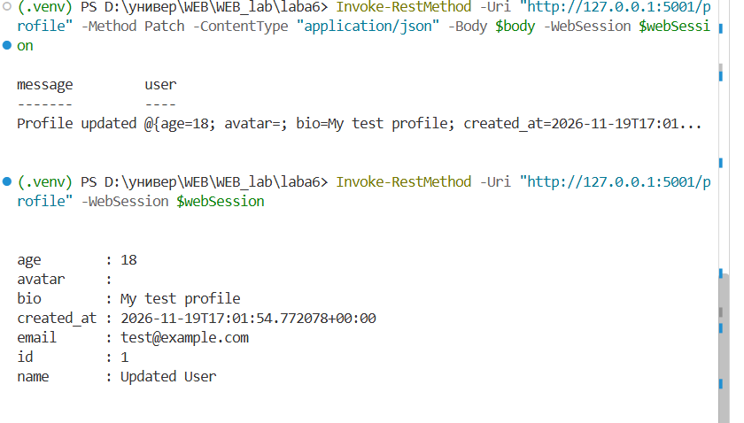

Сервер запущен, в логе виден запрос без cookie (`UNAUTHORIZED: Authentication required`):

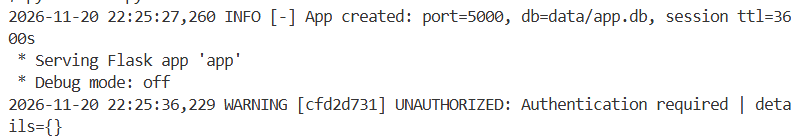

### Проверка сценариев

Регистрация нового пользователя (`201`, в ответе нет пароля и его хэша, `last_login_at` пока `null`). Второй пользователь, Борис, создан для проверки прав.

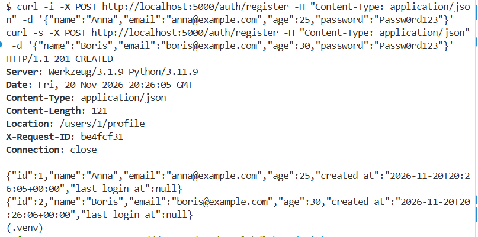

Регистрация с неверными данными возвращает `400` с ошибками по полям (валидация из прошлых лабораторных):

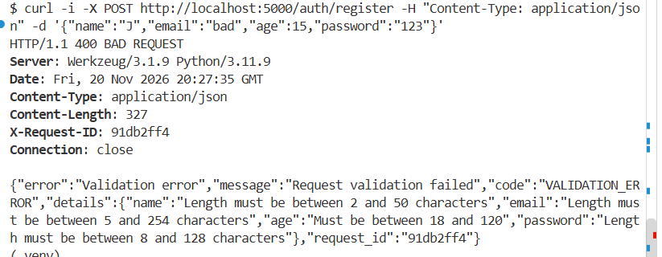

Запрос `/me` без входа возвращает `401`:

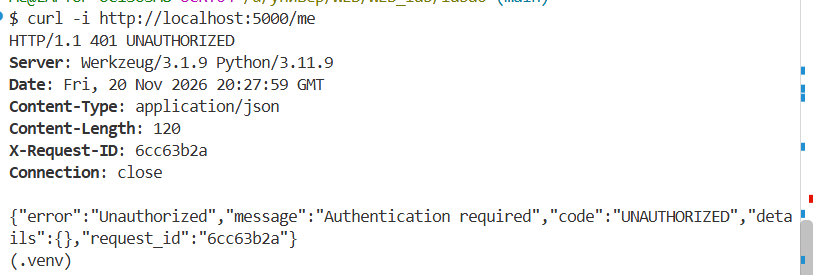

Неверный пароль и попытка SQL-инъекции в поле email (`' OR '1'='1`) дают одинаковый ответ `401 Invalid email or password`. Одно и то же сообщение не раскрывает, существует ли такой email. Инъекция не работает, потому что запросы параметризованные: введённая строка воспринимается как обычное значение.

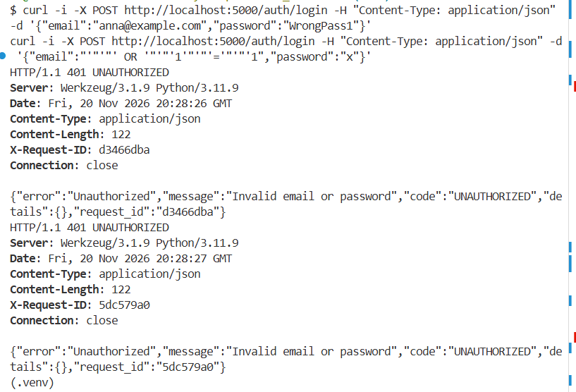

Успешный вход: `200`, заголовок `Set-Cookie` с `HttpOnly` и `SameSite=Lax`, у пользователя заполнено `last_login_at`:

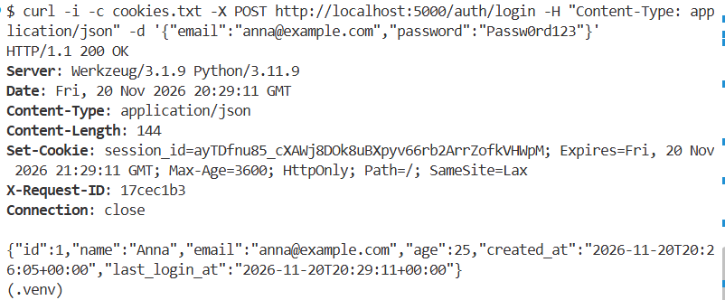

Cookie, сохранённая curl в файле (строка начинается с `#HttpOnly_`):

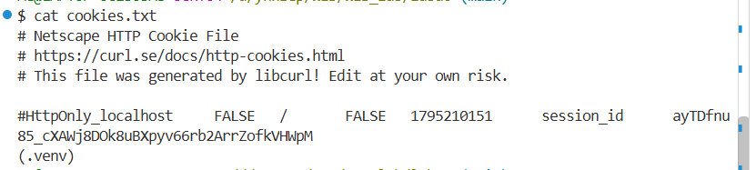

Запрос `/me` с cookie возвращает данные пользователя (`200`):

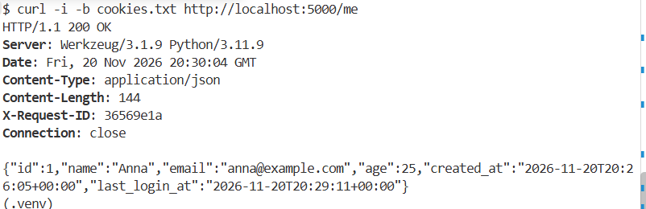

### Выход и срок действия сессии

После выхода (`/auth/logout`) сервер возвращает `204` и стирает cookie. Запрос со старым токеном, который я сохранила до выхода, возвращает `401 Invalid session`, потому что сессия удалена на сервере. С JWT так мгновенно отозвать токен не получилось бы.

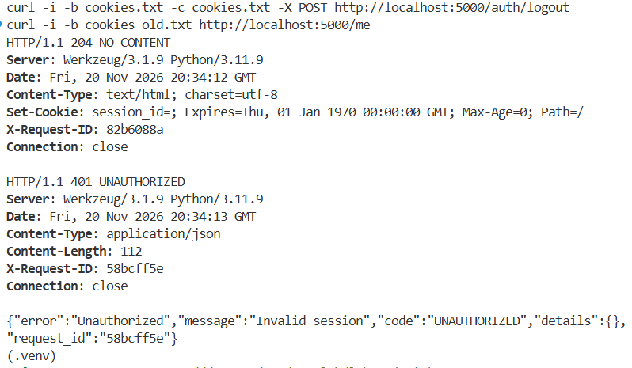

Срок действия: сервер запущен с `SESSION_TTL_SECONDS=5`. Сразу после входа `/me` даёт `200`, а через 6 секунд тот же токен даёт `401 Session expired`. (Токен подставлен вручную в заголовок, чтобы срок проверял именно сервер.)

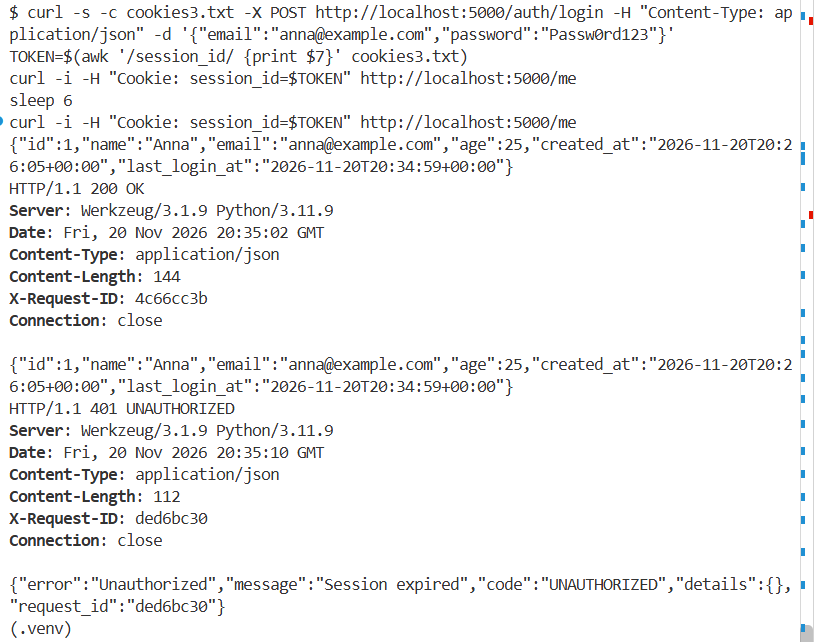

## Профили пользователей

Профиль хранится в отдельной таблице `profiles` (поля `bio`, `city`, `updated_at`). Для сохранения используется upsert (`INSERT ... ON CONFLICT DO UPDATE`): один запрос и создаёт профиль, и обновляет существующий.

Код репозитория профилей (параметризованные запросы и upsert):

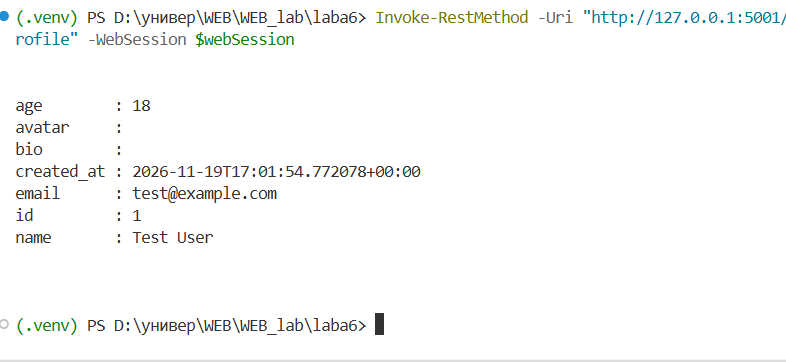

Создание профиля (`PUT`, `200`):

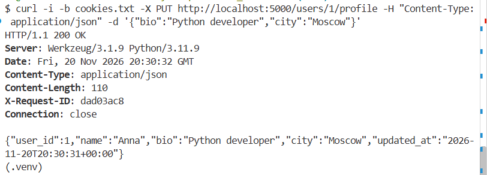

Чтение профиля (`GET`, `200`):

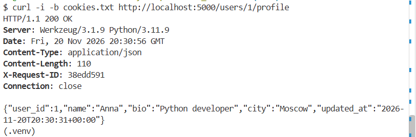

Борис входит под своим аккаунтом и читает профиль Анны: `200`, видны имя, `bio` и `city`, а email не показывается.

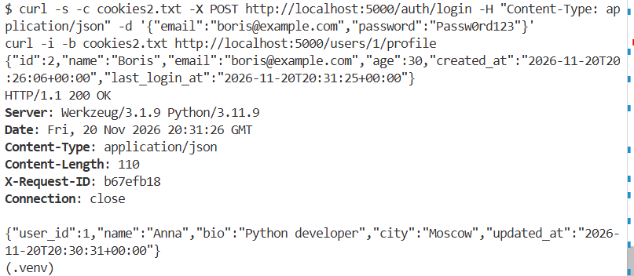

Борис пытается изменить чужой профиль: `403 Forbidden`.

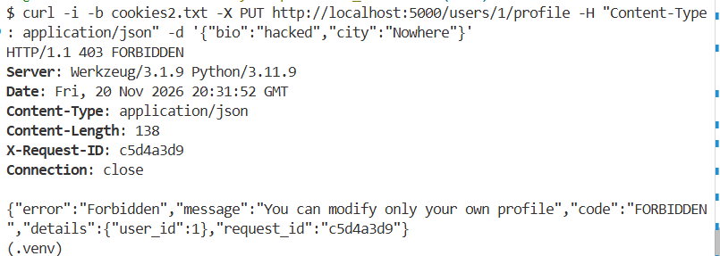

Некорректные данные профиля (`bio` не строка, лишнее поле `role`): `400`.

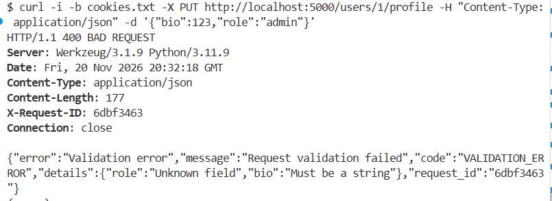

Профиль несуществующего пользователя: `404`.

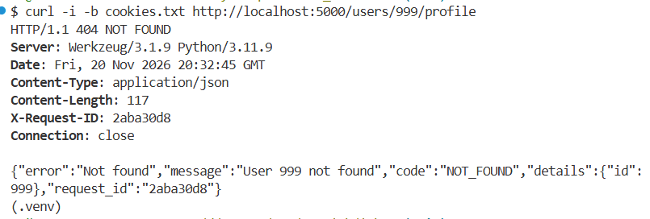

Удаление профиля возвращает `204`, а повторное чтение даёт `200` с `bio: null` и `city: null` (профиля нет, пользователь есть).

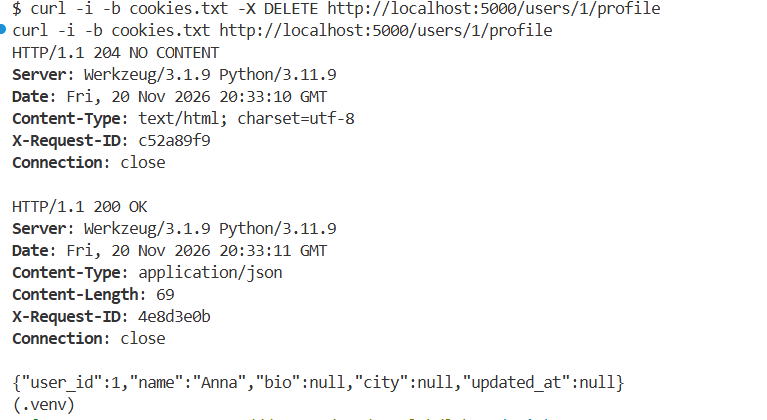

## Работа с базой данных

Содержимое базы: все четыре миграции записаны, у пользователей пароль хранится только в виде хэша (`pbkdf2:sha256`), в таблице `sessions` лежит хэш токена (а не токен из cookie) и срок жизни 3600 секунд. Таблица профилей пуста, так как профиль был удалён выше.

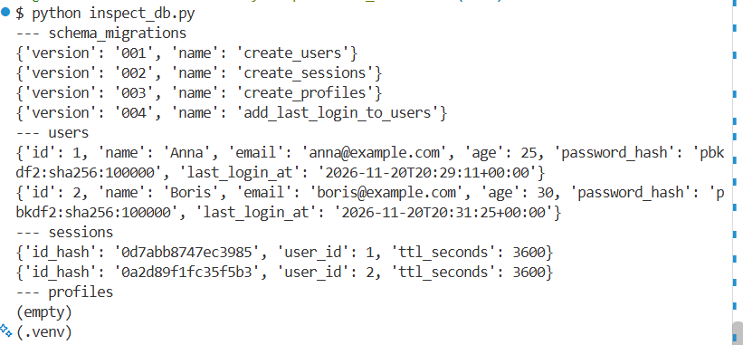

Удаление аккаунта (`DELETE /me`, `204`): Анна пропала из таблицы `users`, и все её сессии удалились вместе с ней. Приложение их отдельно не удаляло, это сделала база благодаря `ON DELETE CASCADE`. Остался только Борис и его сессия.

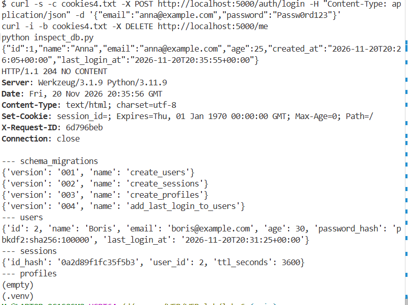

## Docker

Запуск описан в `docker-compose.yml`: контейнер сначала применяет миграции (`python migrate.py up`), затем запускает сервер. База лежит в именованном томе `db_data`.

Сборка и запуск:

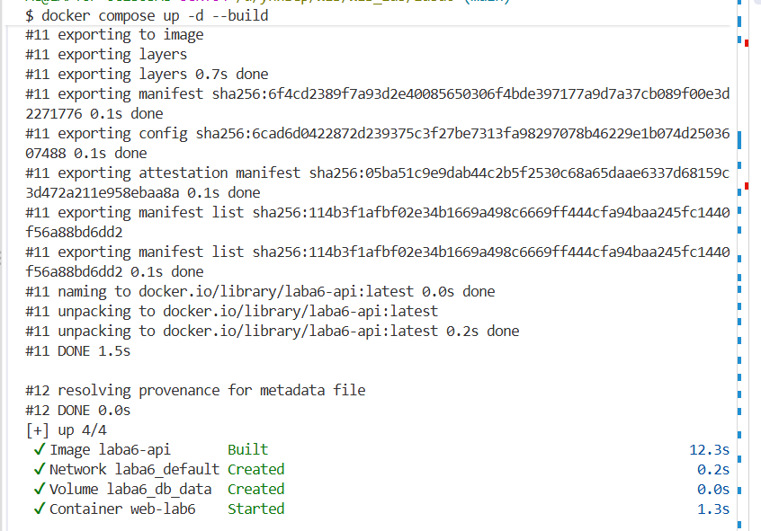

В логах контейнера видно, что при старте применились все четыре миграции:

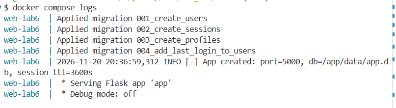

Работа в контейнере: регистрация, вход (`Set-Cookie`) и запрос `/me`.

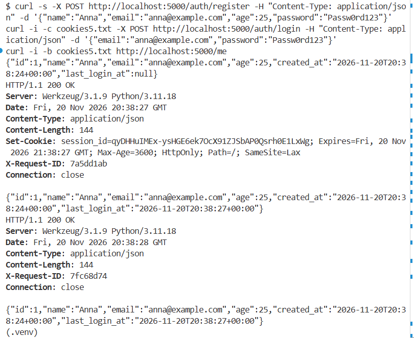

После `docker compose restart` та же cookie по-прежнему работает (`/me` возвращает `200`): сессия хранится в базе, а не в памяти процесса, поэтому переживает перезапуск.

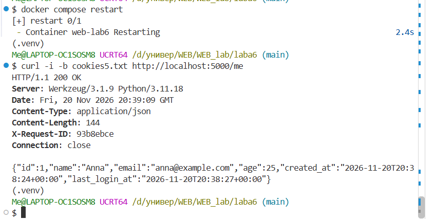

HTTP не хранит состояние, поэтому после входа сервер выдаёт токен сессии в cookie. Браузер присылает её с каждым запросом, а сервер по ней находит сессию и пользователя.

Сессия хранится на сервере: её можно отозвать сразу (выход, смена пароля), но нужно хранилище. JWT хранится у клиента и проверяется по подписи без обращения к базе, но отозвать его до окончания срока сложнее.

 `HttpOnly` защищает от кражи токена через JavaScript (XSS), `SameSite=Lax` не даёт отправлять cookie с чужих сайтов и снижает риск CSRF, `Secure` разрешает передачу только по HTTPS.

Запросы параметризованные: SQL и значения передаются отдельно, поэтому введённые данные не становятся частью команды.

Схема базы версионируется и применяется одинаково на любой машине и в Docker, любое изменение можно откатить командой `down`.

